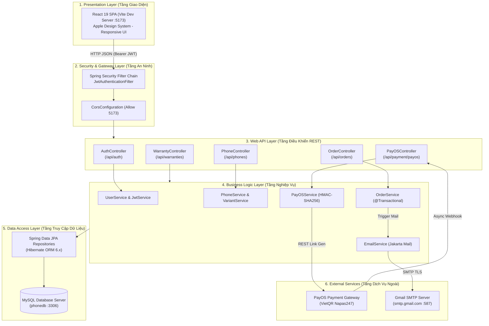
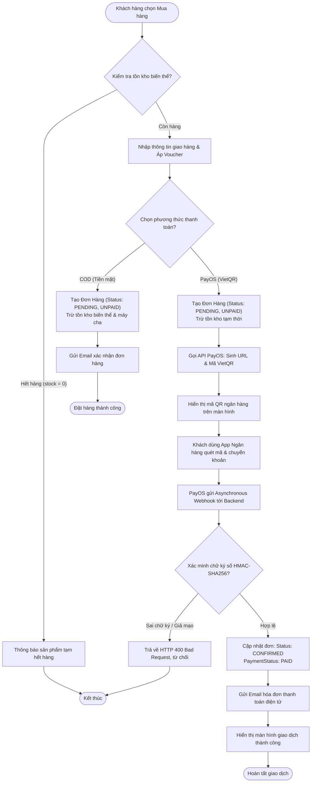
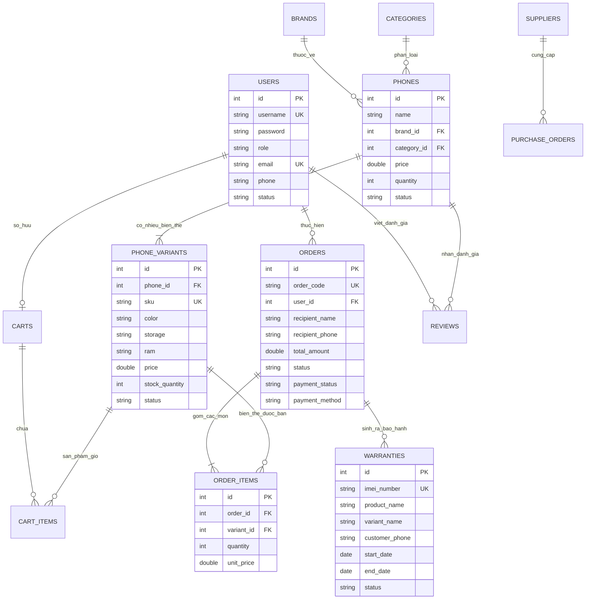

# BỘ CÔNG THƯƠNG
### TRƯỜNG CAO ĐẲNG CÔNG THƯƠNG TP. HỒ CHÍ MINH
### KHOA CÔNG NGHỆ THÔNG TIN
---

<br/><br/>

# BÁO CÁO ĐỒ ÁN MÔN HỌC
## HỌC PHẦN: LẬP TRÌNH JAVA
### ĐỀ TÀI: QUẢN LÝ CỬA HÀNG ĐIỆN THOẠI DI ĐỘNG
**(Hệ Thống Website Bán Điện Thoại Trực Tuyến Tích Hợp Thanh Toán Số PayOS Và Quản Lý Bảo Hành Điện Tử Theo IMEI)**

<br/><br/>

**Giảng viên hướng dẫn:** Thầy Nguyễn Minh Tuấn  
**Lớp học phần:** CCQ2411E  
**Nhóm thực hiện:** Nhóm 10  

**Danh sách thành viên:**
1. **Võ Minh Quang** – MSSV: **2124110166** *(Trưởng nhóm)*
2. **Huỳnh Tấn Tài** – MSSV: **2124110167** *(Thành viên)*

<br/><br/>

---
*TP. Hồ Chí Minh, Tháng 11 Năm 2026*

\newpage

# PHIẾU NHẬN XÉT CỦA GIẢNG VIÊN HƯỚNG DẪN

**Họ và tên Giảng viên:** Thầy Nguyễn Minh Tuấn  
**Học phần:** Lập trình JAVA  
**Tên đề tài:** Quản lý cửa hàng điện thoại di động  
**Nhóm sinh viên thực hiện:** Nhóm 10 — Lớp: CCQ2411E  

* Sinh viên 1: **Võ Minh Quang** – MSSV: **2124110166**
* Sinh viên 2: **Huỳnh Tấn Tài** – MSSV: **2124110167**

---

### I. NỘI DUNG ĐÁNH GIÁ CHUYÊN MÔN

| Tiêu chí đánh giá | Điểm tối đa | Điểm đánh giá | Nhận xét chi tiết của Giảng viên |
|---|:---:|:---:|---|
| **1. Tính cấp thiết, mục tiêu và phạm vi đề tài** | 1.0 | | |
| **2. Cơ sở lý thuyết và hiểu biết về Java/Spring Boot** | 1.5 | | |
| **3. Phân tích, thiết kế hệ thống và CSDL quan hệ** | 2.0 | | |
| **4. Cài đặt mã nguồn, tổ chức tầng & xử lý nghiệp vụ** | 2.5 | | |
| **5. Tích hợp thanh toán số PayOS và dịch vụ ngoài** | 1.0 | | |
| **6. Kiểm thử phần mềm (Unit Test / API Testing)** | 1.0 | | |
| **7. Hình thức báo cáo, thái độ và làm việc nhóm** | 1.0 | | |
| **TỔNG ĐIỂM** | **10.0** | | |

<br/>

### II. Ý KIẾN NHẬN XÉT CHUNG CỦA GIẢNG VIÊN HƯỚNG DẪN

......................................................................................................................................................  
......................................................................................................................................................  
......................................................................................................................................................  
......................................................................................................................................................  
......................................................................................................................................................  

**Kết luận:** Đủ điều kiện bảo vệ trước hội đồng môn học:  [  ] Có  [  ] Không  

<br/>

*TP. Hồ Chí Minh, Ngày ...... Tháng ...... Năm 2026*  
**Giảng viên hướng dẫn**  
*(Ký và ghi rõ họ tên)*  

<br/><br/>
**Thầy Nguyễn Minh Tuấn**

\newpage

# LỜI CẢM ƠN

Trong suốt quá trình học tập môn **Lập trình Java** và hoàn thành đồ án đề tài **"Quản lý cửa hàng điện thoại di động"**, Nhóm 10 chúng em đã nhận được sự định hướng, hỗ trợ và giảng dạy vô cùng quý báu từ quý Thầy Cô trong Khoa Công nghệ Thông tin – Trường Cao đẳng Công thương TP. Hồ Chí Minh.

Trước hết, nhóm chúng em xin bày tỏ lòng biết ơn sâu sắc và chân thành nhất tới **Thầy Nguyễn Minh Tuấn** – Giảng viên trực tiếp phụ trách giảng dạy và hướng dẫn môn học. Thầy đã tận tình truyền đạt những kiến thức chuyên sâu về ngôn ngữ Java, hệ sinh thái Spring Boot, kiến trúc RESTful API chuẩn mực cũng như luôn giải đáp thấu đáo các vướng mắc kỹ thuật, định hướng giải pháp thiết kế cơ sở dữ liệu và bảo mật hệ thống giúp chúng em hoàn thiện sản phẩm một cách chỉn chu, bài bản.

Chúng em cũng xin gửi lời cảm ơn tới Ban Giám hiệu Trường Cao đẳng Công thương TP.HCM cùng toàn thể quý Thầy Cô Khoa Công nghệ Thông tin đã tạo môi trường học tập lý tưởng, trang bị nền tảng tư duy lập trình và kiến trúc phần mềm vững chắc cho chúng em.

Mặc dù cả nhóm đã nỗ lực hết mình để vận dụng kiến thức lý thuyết vào xây dựng hệ thống phần mềm thực tế, song do giới hạn về mặt thời gian và kinh nghiệm, đồ án và bản báo cáo chắc chắn khó tránh khỏi những thiếu sót nhất định. Nhóm 10 rất mong nhận được những lời nhận xét, góp ý quý báu từ Thầy Nguyễn Minh Tuấn và quý Thầy Cô để hệ thống ngày càng hoàn thiện và có thể ứng dụng thực tiễn tốt hơn.

*TP. Hồ Chí Minh, Ngày 06 Tháng 11 Năm 2026*  
**Đại diện Nhóm 10 thực hiện**  
*Trưởng nhóm: Võ Minh Quang*  
*Thành viên: Huỳnh Tấn Tài*  

\newpage

# TÓM TẮT ĐỒ ÁN (ABSTRACT)

Báo cáo trình bày toàn diện quá trình khảo sát nghiệp vụ, phân tích yêu cầu, thiết kế kiến trúc, hiện thực hóa mã nguồn và kiểm thử hệ thống cho đề tài **"Quản lý cửa hàng điện thoại di động"** (Phone Store Management & E-Commerce System). Đề tài giải quyết bài toán cốt lõi trong bán lẻ thiết bị công nghệ: quản lý cấu hình sản phẩm đa biến thể (Color, Storage ROM, RAM, SKU), tự động hóa đồng bộ tồn kho kép, thanh toán số tự động qua mã VietQR Napas247 và số hóa vòng đời bảo hành điện tử theo số định danh phần cứng (IMEI).

Hệ thống được xây dựng theo kiến trúc hiện đại phân tách độc lập (Decoupled Architecture):
* **Backend:** Phát triển trên nền tảng **Java 25 (OpenJDK)** và khung ứng dụng **Spring Boot 3.5.0**, áp dụng mô hình phân lớp chuẩn công nghiệp (Controller – Service – Repository). Hệ thống quản lý dữ liệu với **Spring Data JPA** và **Hibernate ORM** kết nối hệ quản trị CSDL quan hệ **MySQL 8.0**. Tầng bảo mật xây dựng theo mô hình vô trạng thái (Stateless) với **Spring Security 6.x**, thẩm định truy cập bằng **JSON Web Token (JWT)** và mã hóa mật khẩu một chiều **BCrypt**.
* **Frontend:** Ứng dụng Single Page Application (SPA) xây dựng trên nền tảng **React 19** kết hợp công cụ đóng gói siêu tốc **Vite**, áp dụng hệ thống thiết kế **Apple Design System** mang lại trải nghiệm duyệt sản phẩm tinh gọn, hiện đại và tối ưu hiệu năng.
* **Tích hợp ngoại vi:** Tích hợp cổng thanh toán trực tuyến **PayOS** với giải thuật ký băm số chống giả mạo **HMAC-SHA256** và cơ chế xác thực Webhook đối soát bất đồng bộ; tích hợp phân hệ gửi thư tự động qua giao thức **Gmail SMTP** bằng Jakarta Mail.

Kết quả kiểm thử tự động với JUnit 5 và Postman khẳng định hệ thống vận hành ổn định, dữ liệu đồng bộ chính xác, loại trừ triệt để nguy cơ bán vượt tồn kho (Over-selling) và đáp ứng đầy đủ các tiêu chuẩn học thuật của học phần Lập trình Java.

\newpage

# MỤC LỤC TỔNG QUAN

* **PHIẾU NHẬN XÉT CỦA GIẢNG VIÊN HƯỚNG DẪN**
* **LỜI CẢM ƠN**
* **TÓM TẮT ĐỒ ÁN (ABSTRACT)**
* **MỤC LỤC TỔNG QUAN**
* **DANH MỤC CÁC BẢNG BIỂU VÀ SƠ ĐỒ**
* **CHƯƠNG 1: GIỚI THIỆU ĐỀ TÀI**
  * 1.1. Lý do chọn đề tài và Tính cấp thiết thực tiễn
  * 1.2. Mục tiêu nghiên cứu và Phạm vi đề tài
  * 1.3. Yêu cầu hệ thống
    * 1.3.1. Yêu cầu chức năng (Functional Requirements)
    * 1.3.2. Yêu cầu phi chức năng (Non-Functional Requirements)
  * 1.4. Công nghệ sử dụng và Vai trò trong hệ thống (Bảng 4.1)
* **CHƯƠNG 2: CƠ SỞ LÝ THUYẾT VÀ CÔNG NGHỆ ỨNG DỤNG**
  * 2.1. Khung ứng dụng Spring Boot và Hệ sinh thái Spring
  * 2.2. Kiến trúc Giao diện Lập trình Ứng dụng RESTful API
  * 2.3. Quản trị Dữ liệu quan hệ với Spring Data JPA & Hibernate
  * 2.4. An toàn Thông tin với Spring Security và JSON Web Token (JWT)
  * 2.5. Các Công nghệ và Dịch vụ Tích hợp Ngoại vi
* **CHƯƠNG 3: PHÂN TÍCH VÀ THIẾT KẾ HỆ THỐNG**
  * 3.1. Mô tả bài toán nghiệp vụ và Phân loại tác nhân
  * 3.2. Danh sách chức năng theo từng tác nhân (Bảng 4.2)
  * 3.3. Đặc tả Luồng Xử lý Dữ liệu các Chức năng Quan trọng (I/O & Business Logic)
  * 3.4. Mô hình hóa Hệ thống (Sơ đồ Use Case và Activity Diagram)
  * 3.5. Thiết kế Cơ sở Dữ liệu Quan hệ
    * 3.5.1. Sơ đồ Quan hệ Thực thể (ERD)
    * 3.5.2. Từ điển Dữ liệu và Ràng buộc Toàn vẹn (Bảng 4.3)
  * 3.6. Thiết kế Giao diện Người dùng và Luồng Tương tác
  * 3.7. Đặc tả Danh mục RESTful API Endpoints (Bảng 4.4)
* **CHƯƠNG 4: CÀI ĐẶT VÀ TRIỂN KHAI HỆ THỐNG**
  * 4.1. Môi trường Thực thi và Công cụ Phát triển
  * 4.2. Tổ chức Cấu trúc Mã nguồn (Project Directory Structure)
  * 4.3. Cài đặt các Phân hệ Nghiệp vụ Cốt lõi (Trích dẫn & Phân tích Mã Nguồn)
    * 4.3.1. Cấu hình Chuỗi lọc An ninh và Xác thực JWT
    * 4.3.2. Nghiệp vụ Quản lý Sản phẩm theo Biến thể Master-Detail
    * 4.3.3. Nghiệp vụ Đặt hàng và Đồng bộ Trừ Tồn Kho Kép
    * 4.3.4. Tích hợp Cổng thanh toán VietQR PayOS và Thẩm định Webhook HMAC-SHA256
    * 4.3.5. Nghiệp vụ Tra cứu và Kích hoạt Bảo hành Điện tử theo IMEI
  * 4.4. Tích hợp Dịch vụ Gửi Thư Điện tử Tự động (Gmail SMTP)
  * 4.5. Hướng dẫn Triển khai và Vận hành Hệ thống
* **CHƯƠNG 5: KIỂM THỬ HỆ THỐNG**
  * 5.1. Chiến lược và Công cụ Kiểm thử
  * 5.2. Kết quả Thực thi Kiểm thử Tự động (Unit Test với JUnit 5)
  * 5.3. Bảng Ca Kiểm thử Nghiệp vụ và Tích hợp API (Bảng 4.5)
* **CHƯƠNG 6: KẾT QUẢ, ĐÁNH GIÁ VÀ HƯỚNG PHÁT TRIỂN**
  * 6.1. Tổng kết Chức năng Hoàn thành đối chiếu Mục tiêu Đề tài
  * 6.2. Đánh giá Chất lượng Triển khai Kỹ thuật Java & Spring Boot
  * 6.3. Những Hạn chế Hiện tại của Hệ thống
  * 6.4. Định hướng Phát triển và Nâng cấp Đề tài
* **KẾT LUẬN**
* **TÀI LIỆU THAM KHẢO**
* **PHỤ LỤC**
  * Phụ lục A: Bảng Phân công Nhiệm vụ Nhóm 10 (Bảng 4.6)
  * Phụ lục B: Đường dẫn Mã nguồn, Postman Collection và Kịch bản CSDL
  * Phụ lục C: Danh mục Tài khoản Thử nghiệm và Thông tin Cấu hình

\newpage

# DANH MỤC CÁC BẢNG BIỂU VÀ SƠ ĐỒ

### Danh mục Bảng
* **Bảng 4.1:** Bảng tổng hợp công nghệ sử dụng trong hệ thống
* **Bảng 4.2:** Bảng phân rã chức năng theo tác nhân sử dụng (Role-based Feature Matrix)
* **Bảng 4.3:** Bảng thiết kế cơ sở dữ liệu quan hệ hệ thống `phonedb`
* **Bảng 4.4:** Bảng danh mục Endpoints RESTful API hệ thống
* **Bảng 4.5:** Bảng tổng hợp kịch bản và kết quả kiểm thử hệ thống (Test Cases)
* **Bảng 4.6:** Bảng phân công nhiệm vụ và tỷ lệ hoàn thành của thành viên Nhóm 10

### Danh mục Sơ đồ và Hình vẽ
* **Sơ đồ 2.1:** Kiến trúc tổng thể phân tầng hệ thống (Decoupled Fullstack Architecture)
* **Sơ đồ 3.1:** Sơ đồ Use Case tổng quát hệ thống Phone Store
* **Sơ đồ 3.2:** Sơ đồ Activity Diagram quy trình Đặt hàng và Thanh toán QR PayOS
* **Sơ đồ 3.3:** Sơ đồ Activity Diagram quy trình Kích hoạt & Tra cứu Bảo hành điện tử IMEI
* **Sơ đồ 3.4:** Sơ đồ Quan hệ Thực thể Cơ sở dữ liệu (Entity-Relationship Diagram - ERD)
* **Sơ đồ 4.1:** Sơ đồ tuần tự (Sequence Diagram) luồng xác thực vô trạng thái với JWT
* **Sơ đồ 4.2:** Sơ đồ tuần tự (Sequence Diagram) luồng tạo giao dịch VietQR và tiếp nhận Webhook PayOS

\newpage

---

# CHƯƠNG 1: GIỚI THIỆU ĐỀ TÀI

## 1.1. Lý do chọn đề tài và Tính cấp thiết thực tiễn
Trong kỷ nguyên chuyển đổi số và thương mại điện tử bùng nổ, ngành bán lẻ thiết bị di động thông minh (Smartphone) là một trong những lĩnh vực có tốc độ tăng trưởng doanh thu cao nhất nhưng cũng đòi hỏi quy chuẩn quản lý nghiêm ngặt nhất. Khác với các mặt hàng thông thường (như thời trang hay sách báo), điện thoại di động sở hữu những đặc tính kinh doanh rất riêng biệt:
1. **Tính đa dạng về cấu hình phần cứng (Biến thể sản phẩm):** Cùng một mẫu điện thoại (ví dụ: iPhone 15 Pro) nhưng lại tồn tại hàng chục lựa chọn khác nhau về màu sắc (Titan Tự Nhiên, Titan Đen, Titan Xanh), bộ nhớ trong ROM (128GB, 256GB, 512GB, 1TB) và dung lượng RAM. Mỗi biến thể có mã quản lý kho (SKU) riêng biệt, mức giá chênh lệch lớn và số lượng tồn kho tách bạch. Việc các hệ thống đơn giản gộp chung thông tin dẫn đến sai lệch kho hàng nghiêm trọng.
2. **Yêu cầu bảo hành theo định danh phần cứng (Mã IMEI):** Mỗi chiếc điện thoại xuất xưởng được định danh duy nhất bởi số IMEI gồm 15 chữ số. Hình thức cấp sổ bảo hành bằng giấy truyền thống bộc lộ vô số nhược điểm: dễ nhàu nát, rách hỏng, làm giả thông tin và gây khó khăn tột độ cho khách hàng khi đi bảo dưỡng. Nhu cầu số hóa cổng tra cứu bảo hành điện tử công khai là cấp thiết.
3. **Thanh toán số tự động hóa:** Phương thức trả tiền mặt khi nhận hàng (COD) tiềm ẩn rủi ro "bom hàng" cao và chi phí xử lý tiền mặt lớn. Người tiêu dùng hiện nay có thói quen quét mã VietQR ngân hàng. Do đó, tích hợp cổng thanh toán hỗ trợ chuẩn VietQR Napas247 có cơ chế tự động đối soát đơn hàng theo thời gian thực (Real-time reconciliation) là tiêu chuẩn sống còn của một trang thương mại điện tử hiện đại.

Trước yêu cầu học thuật của học phần **Lập trình Java** tại Khoa Công nghệ Thông tin – Trường Cao đẳng Công thương TP.HCM và tính cấp thiết của thực tiễn kinh doanh, Nhóm 10 đã quyết định lựa chọn đề tài: **"Quản lý cửa hàng điện thoại di động"**. Đề tài là cơ hội để các thành viên áp dụng chuyên sâu kiến thức lập trình Java hướng đối tượng, làm chủ nền tảng Spring Boot, Spring Data JPA, giải quyết bài toán giao dịch CSDL ACID và thiết kế hệ thống thương mại điện tử hoàn chỉnh.

## 1.2. Mục tiêu nghiên cứu và Phạm vi đề tài

### 1.2.1. Mục tiêu đề tài
* **Về mặt học thuật và kỹ thuật:**
  * Vận dụng thành thạo ngôn ngữ lập trình Java (bản phát hành hiện đại Java 25) và các nguyên lý lập trình hướng đối tượng (OOP).
  * Làm chủ kiến trúc ứng dụng Spring Boot 3.5, tổ chức mã nguồn chuẩn mô hình phân tầng: Controller – Service – Repository – Model/DTO.
  * Thiết kế cơ sở dữ liệu quan hệ chuẩn hóa (3NF) trên MySQL, quản lý tương tác dữ liệu thông qua Hibernate ORM và Spring Data JPA.
  * Xây dựng cơ chế an toàn thông tin bằng Spring Security 6.x, xác thực không lưu phiên (Stateless) bằng JSON Web Token (JWT).
  * Tích hợp thành công dịch vụ ngoài: Cổng thanh toán trực tuyến PayOS (xác thực chữ ký số HMAC-SHA256) và dịch vụ gửi email tự động Jakarta Mail SMTP.
* **Về mặt ứng dụng thực tiễn:**
  * Xây dựng hệ sinh thái website bán hàng trực quan, tinh tế theo chuẩn Apple Design System.
  * Quản trị toàn diện chu trình sản phẩm: từ danh mục, hãng sản xuất, dòng máy cha tới từng biến thể màu sắc, dung lượng và giá bán.
  * Tự động hóa hoàn toàn quy trình đặt hàng, tính toán mã giảm giá Voucher, thanh toán quét mã QR chuyển khoản và kích hoạt bảo hành điện tử theo IMEI.

### 1.2.2. Phạm vi đề tài
* **Đối tượng phục vụ:**
  * *Khách vãng lai (Guest):* Người dùng truy cập xem catalog sản phẩm, lọc theo cấu hình/giá, tra cứu bảo hành điện tử công khai theo IMEI.
  * *Khách hàng thành viên (User):* Có tài khoản cá nhân, quản lý giỏ hàng trực tuyến, đặt hàng, thanh toán qua cổng số PayOS, theo dõi lịch sử đơn hàng.
  * *Quản trị viên (Admin):* Có toàn quyền quản trị dữ liệu sản phẩm, phân loại biến thể, xử lý duyệt đơn hàng, kích hoạt bảo hành, cấu hình mã voucher và theo dõi báo cáo.
* **Giới hạn hệ thống (System Boundaries):**
  * Hệ thống triển khai trên môi trường máy chủ cục bộ phục vụ công tác giảng dạy, đánh giá và kiểm thử đồ án.
  * Cổng thanh toán PayOS được thử nghiệm và đối soát thông qua môi trường PayOS Sandbox liên kết mạng lưới ngân hàng giả lập VietQR Napas247.

## 1.3. Yêu cầu hệ thống

### 1.3.1. Yêu cầu chức năng (Functional Requirements)
1. **Phân hệ Quản lý Xác thực & Tài khoản:** Đăng ký tài khoản, đăng nhập hệ thống cấp phát thẻ bài JWT, phân quyền truy cập theo vai trò (`ROLE_ADMIN`, `ROLE_USER`), thay đổi mật khẩu và khôi phục mật khẩu qua Email.
2. **Phân hệ Quản lý Danh mục & Dòng máy:** Quản lý danh mục loại máy (Categories), thương hiệu sản xuất (Brands: Apple, Samsung, Xiaomi,...), thêm mới và điều chỉnh thông tin dòng sản phẩm chính (Phones).
3. **Phân hệ Biến thể Sản phẩm (Phone Variants):** Cho phép một dòng máy có nhiều biến thể; quản lý chi tiết mã SKU, thông số RAM, bộ nhớ trong (Storage), màu sắc hiển thị, giá bán riêng và số lượng tồn kho từng loại.
4. **Phân hệ Giỏ hàng & Khuyến mãi (Cart & Vouchers):** Lưu trữ giỏ hàng độc lập theo tài khoản người dùng, tự động tính tổng tiền, kiểm tra tồn kho tức thời, áp dụng mã giảm giá theo ngưỡng đơn hàng tối thiểu.
5. **Phân hệ Đặt hàng & Xử lý Giao dịch (Orders):** Tiếp nhận thông tin người nhận, địa chỉ giao hàng, phương thức thanh toán (COD hoặc PayOS), ghi nhận trạng thái đơn hàng (`PENDING`, `CONFIRMED`, `SHIPPING`, `DELIVERED`, `CANCELLED`).
6. **Phân hệ Thanh toán số VietQR (PayOS Integration):** Tạo mã thanh toán động kèm mã giao dịch duy nhất, sinh liên kết quét mã VietQR ngân hàng, tiếp nhận Webhook phản hồi kết quả chuyển khoản tức thời và thẩm định chữ ký số chống giả mạo.
7. **Phân hệ Quản lý & Tra cứu Bảo hành (E-Warranty):** Quản trị viên kích hoạt số IMEI gắn liền với đơn hàng thành công; khách hàng tra cứu công khai thời hạn bảo hành, lịch sử mua hàng chỉ bằng số IMEI hoặc số điện thoại.

### 1.3.2. Yêu cầu phi chức năng (Non-Functional Requirements)
* **Tính bảo mật (Security):** Mật khẩu bắt buộc được mã hóa một chiều bằng giải thuật băm có muối (Salted BCrypt Hash); Token JWT có thời hạn hiệu lực và được ký số bí mật; cơ chế phân quyền bảo vệ chặt chẽ ở cấp độ phương thức và URL.
* **Tính toàn vẹn dữ liệu (Data Integrity):** Xử lý giao dịch trừ kho và xác nhận thanh toán đặt trong khối giao dịch nguyên tử `@Transactional`; ngăn chặn triệt để tình trạng bán vượt tồn kho (Over-selling) khi có nhiều kết nối đồng thời.
* **Tính dễ sử dụng & Trải nghiệm (Usability & UI/UX):** Giao diện thiết kế theo phong cách Apple tối giản, trang nhã, phông chữ chuẩn San Francisco/Inter, hỗ trợ giao diện đáp ứng (Responsive) trên màn hình máy tính và điện thoại.
* **Hiệu năng & Khả năng mở rộng (Performance & Scalability):** Thời gian phản hồi của các REST API đọc dữ liệu đạt dưới 300ms; thiết kế kiến trúc chuẩn RESTful API không lưu phiên giúp máy chủ dễ dàng mở rộng theo chiều ngang.

## 1.4. Công nghệ sử dụng và Vai trò trong hệ thống

Dưới đây là bảng tổng hợp các công nghệ, nền tảng và công cụ được sử dụng để phát triển hệ thống, đáp ứng đầy đủ yêu cầu theo mẫu biểu quy định của học phần:

#### Bảng 4.1: Bảng công nghệ sử dụng trong hệ thống
| Nhóm công nghệ | Công nghệ / Nền tảng | Phiên bản | Vai trò kỹ thuật trong hệ thống |
|---|---|:---:|---|
| **Ngôn ngữ lập trình cốt lõi** | Java (OpenJDK) | 25.0.1 | Ngôn ngữ nền tảng hướng đối tượng, biên dịch và thực thi toàn bộ logic nghiệp vụ phía máy chủ (Backend). |
| **Khung ứng dụng Backend** | Spring Boot | 3.5.0 | Khung phát triển ứng dụng Java doanh nghiệp, cung cấp cấu hình tự động (Auto-configuration), máy chủ nhúng Tomcat và quản lý vòng đời Bean (IoC/DI). |
| **Giao tiếp Dịch vụ Web** | Spring Web (RESTful API) | 3.5.0 | Tiếp nhận các yêu cầu HTTP (GET, POST, PUT, DELETE), ánh xạ JSON DTO và trả lời kết quả cho ứng dụng Frontend. |
| **Quản trị & Tương tác Dữ liệu** | Spring Data JPA / Hibernate | 3.5.0 | Đóng vai trò ORM (Object-Relational Mapping), tự động ánh xạ lớp thực thể Java thành các bảng MySQL, sinh mã truy vấn CRUD tự động qua `JpaRepository`. |
| **Hệ thống An toàn & Bảo mật** | Spring Security & JJWT | 6.x / 0.12.6 | Xây dựng chuỗi lọc `SecurityFilterChain`, quản lý cơ chế xác thực vô trạng thái (Stateless), giải mã và xác minh thẻ bài JSON Web Token. |
| **Cơ sở dữ liệu quan hệ** | MySQL Community Server | 8.0.36 | Hệ quản trị CSDL quan hệ lưu trữ bền vững toàn bộ thực thể kinh doanh (sản phẩm, người dùng, đơn hàng, bảo hành). |
| **Giao diện Người dùng (Frontend)** | React.js + Vite | 19.0 / 8.3 | Thư viện xây dựng Single Page Application (SPA), render giao diện người dùng linh hoạt, quản lý State và kết nối REST API. |
| **Hệ thống Thiết kế UI** | CSS3 & Apple Design System | CSS3 | Định hình phong cách thị giác cao cấp: Gallery White, Ink, San Francisco Typography, bo góc 28px và tương phản tối giản. |
| **Cổng thanh toán trực tuyến** | PayOS SDK / Open API | 2026 Spec | Tích hợp giải pháp thanh toán số Napas247, tự động sinh mã VietQR và gửi Webhook đối soát với chữ ký bảo mật HMAC-SHA256. |
| **Dịch vụ Gửi thư điện tử** | Spring Mail (Jakarta Mail) | 3.5.0 | Kết nối máy chủ Gmail SMTP để gửi email xác nhận đặt hàng và mã khôi phục mật khẩu tự động cho khách hàng. |
| **Công cụ Kiểm thử** | JUnit 5 & Postman | 5.10 / 11.x | JUnit 5 kiểm thử đơn vị tự động tại Backend (`DemoApplicationTests.java`); Postman kiểm thử tích hợp toàn bộ các kịch bản REST API. |
| **Quản lý Dự án & Bản quyền mã** | Apache Maven & Git | 3.9 / 2.4x | Quản lý phụ thuộc thư viện (`pom.xml`), quy trình build và quản lý lịch sử phiên bản mã nguồn trên GitHub. |

\newpage

---

# CHƯƠNG 2: CƠ SỞ LÝ THUYẾT VÀ CÔNG NGHỆ ỨNG DỤNG

Để đảm bảo báo cáo tập trung sâu vào thực tiễn kỹ thuật của đề tài, chương này chỉ giới thiệu tóm lược những nền tảng công nghệ được ứng dụng trực tiếp, đi kèm ví dụ minh họa cụ thể từ chính mã nguồn hệ thống Phone Store.

## 2.1. Khung ứng dụng Spring Boot và Hệ sinh thái Spring
Spring Boot là một dự án nổi bật trong hệ sinh thái Spring Framework, giúp đơn giản hóa tối đa quy trình khởi tạo, cấu hình và triển khai các ứng dụng doanh nghiệp độc lập dựa trên Java:
* **Nguyên lý Inversion of Control (IoC) và Dependency Injection (DI):** Thay vì các lớp phải tự khởi tạo phụ thuộc bằng từ khóa `new`, Spring IoC Container tự động quản lý vòng đời và "tiêm" (inject) các phụ thuộc cần thiết thông qua cơ chế tự động `@Autowired` hoặc Constructor Injection.
  * *Ví dụ trong đồ án:* Lớp [`PhoneServiceImpl`](file:///d:/phone-java/src/main/java/com/example/demoSpringBoot/service/impl/PhoneServiceImpl.java) được Spring Container tự động tiêm đối tượng `PhoneRepository` và `CategoryRepository` vào constructor mà không cần khởi tạo thủ công.
* **Cơ chế Cấu hình tự động (Auto-Configuration):** Dựa trên khai báo phụ thuộc trong file `pom.xml`, Spring Boot tự động nhận diện Driver MySQL và thiết lập cấu hình kết nối CSDL, máy chủ nhúng Tomcat chạy trên cổng 8080 mà không cần viết các tệp cấu hình XML phức tạp.

## 2.2. Kiến trúc Giao diện Lập trình Ứng dụng RESTful API
REST (Representational State Transfer) là kiểu kiến trúc phần mềm chuẩn mực cho các hệ thống web hiện đại:
* **Tính vô trạng thái (Statelessness):** Máy chủ không lưu trữ phiên làm việc của người dùng trong bộ nhớ RAM (`HttpSession`). Mọi thông tin nhận diện người dùng bắt buộc phải gửi kèm trong mỗi Request.
* **Chuẩn hóa phương thức HTTP:**
  * `GET`: Truy vấn và lấy thông tin (ví dụ: `GET /api/phones` để lấy danh sách máy).
  * `POST`: Tạo mới tài nguyên (ví dụ: `POST /api/orders` để tạo đơn hàng mới).
  * `PUT`: Cập nhật toàn bộ hoặc một phần tài nguyên (ví dụ: `PUT /api/phones/{id}`).
  * `DELETE`: Xóa tài nguyên (ví dụ: `DELETE /api/phones/{id}`).
* **Định dạng dữ liệu JSON:** Toàn bộ thông điệp trao đổi giữa ứng dụng React và Spring Boot đều được biểu diễn dưới dạng JSON (JavaScript Object Notation), ánh xạ thông qua thư viện Jackson.

## 2.3. Quản trị Dữ liệu quan hệ với Spring Data JPA & Hibernate
Spring Data JPA là lớp trừu tượng hóa cao cấp nằm trên nền JPA (Java Persistence API) và Hibernate ORM:
* **Object-Relational Mapping (ORM):** Cho phép ánh xạ trực tiếp các bảng trong CSDL MySQL thành các lớp Java Entity (ví dụ: bảng `phones` ánh xạ thành class [`Phone.java`](file:///d:/phone-java/src/main/java/com/example/demoSpringBoot/model/Phone.java)). Các mối quan hệ quan hệ như Một-Nhiều (`@OneToMany`), Nhiều-Một (`@ManyToOne`) được thể hiện trực quan bằng mã Java.
* **Tự động sinh phương thức truy vấn (Query Method Derivation):** Chỉ cần khai báo tên phương thức trong Interface kế thừa `JpaRepository<T, ID>`, Spring Data JPA tự động dịch thành câu lệnh SQL tương ứng mà lập trình viên không phải viết một dòng SQL nào:
  ```java
  // Tự động sinh câu SQL: SELECT * FROM phone_variants WHERE phone_id = ?
  List<PhoneVariant> findByPhoneId(Integer phoneId);
  ```
* **Quản lý Giao dịch với `@Transactional`:** Đảm bảo 4 thuộc tính ACID (Atomicity, Consistency, Isolation, Durability). Khi thực hiện đặt hàng, thao tác trừ tồn kho biến thể và lưu đơn hàng nằm chung trong một giao dịch. Nếu xảy ra sự cố ở bất kỳ bước nào, toàn bộ thao tác sẽ tự động được thu hồi (Rollback), bảo vệ tính toàn vẹn dữ liệu.

## 2.4. An toàn Thông tin với Spring Security và JSON Web Token (JWT)
Hệ thống triển khai mô hình bảo mật hiện đại không lưu phiên kết hợp Spring Security và JJWT:
* **Cơ chế hoạt động của JSON Web Token:** JWT là một chuỗi mã hóa nhỏ gọn gồm 3 phần tách biệt bởi dấu chấm (`.`):
  1. *Header:* Chứa thuật toán ký băm (ví dụ: `{"alg": "HS256", "typ": "JWT"}`).
  2. *Payload:* Chứa các Claims lưu thông tin danh tính (username, user_id, roles, expiration time).
  3. *Signature:* Chữ ký số được tính toán bằng khóa bí mật phía máy chủ (`jwt.secret`):
     $$\text{Signature} = \text{HMAC-SHA256}(\text{base64UrlEncode}(\text{Header}) + "." + \text{base64UrlEncode}(\text{Payload}), \text{secretKey})$$
* **Mã hóa Mật khẩu một chiều với BCrypt:** Mật khẩu khi lưu vào CSDL không bao giờ ở dạng văn bản gốc mà được băm bằng thuật toán `BCryptPasswordEncoder` kết hợp chuỗi ngẫu nhiên (Salt), chống lại các cuộc tấn công dạng bảng cầu vồng (Rainbow Table).

## 2.5. Các Công nghệ và Dịch vụ Tích hợp Ngoại vi
* **Cổng thanh toán PayOS (VietQR Napas247):** Cung cấp API tạo liên kết thanh toán chuẩn ngân hàng. Điểm mấu chốt là bảo mật Webhook: PayOS gửi dữ liệu thanh toán kèm chữ ký số `signature`. Phía máy chủ Spring Boot thực hiện gom các khóa dữ liệu theo thứ tự A-Z, tính toán chuỗi băm HMAC-SHA256 với `checksumKey` và so sánh để xác thực tính toàn vẹn tuyệt đối trước khi cập nhật đơn hàng thành công.
* **Giao thức gửi thư Jakarta Mail (Gmail SMTP):** Tận dụng cổng TLS 587 của máy chủ Google để tự động chuyển tải email định dạng HTML chuyên nghiệp đến hòm thư người mua ngay khi giao dịch thành công.


*Sơ đồ 2.1: Kiến trúc tổng thể phân tầng hệ thống (Decoupled Fullstack Architecture)*

\newpage

---

# CHƯƠNG 3: PHÂN TÍCH VÀ THIẾT KẾ HỆ THỐNG

## 3.1. Mô tả bài toán nghiệp vụ và Phân loại tác nhân

### 3.1.1. Mô tả bài toán nghiệp vụ
Hệ thống **Phone Store** phục vụ mô hình kinh doanh bán lẻ thiết bị di động trực tuyến kết hợp với quản trị hậu cần kho bãi và trung tâm chăm sóc bảo hành. Quy trình nghiệp vụ cốt lõi diễn ra như sau:
1. **Duyệt và Lựa chọn sản phẩm:** Khách hàng tiếp cận website, tìm kiếm sản phẩm theo tên hoặc hãng sản xuất. Tại trang chi tiết, khách chọn phiên bản cấu hình mong muốn (ví dụ: iPhone 15 Pro, màu Titan Tự Nhiên, dung lượng 256GB). Hệ thống phản hồi tức thời giá bán tương ứng và số lượng tồn kho của biến thể đó.
2. **Quy trình Mua hàng & Thanh toán:** Khách thêm vào giỏ hàng hoặc chọn "Mua ngay", nhập thông tin giao nhận và mã ưu đãi (nếu có). Với phương thức thanh toán chuyển khoản, hệ thống tạo liên kết thanh toán qua PayOS hiển thị mã VietQR. Khách dùng ứng dụng ngân hàng quét mã; máy chủ PayOS nhận diện giao dịch thành công và gửi Webhook đối soát tự động cập nhật trạng thái đơn sang `PAID` và gửi email cho khách.
3. **Quản trị Vận hành & Kích hoạt bảo hành:** Quản trị viên theo dõi danh sách đơn hàng mới, duyệt đơn xuất kho và nhập mã IMEI cho từng thiết bị bán ra để kích hoạt hồ sơ bảo hành điện tử.
4. **Hậu mãi & Chăm sóc khách hàng:** Bất kỳ lúc nào, khách hàng chỉ cần nhập mã IMEI vào cổng tra cứu để xem toàn bộ thông tin nguồn gốc, ngày kích hoạt và thời hạn bảo hành còn lại của máy.

### 3.1.2. Phân loại tác nhân hệ thống
* **1. Khách vãng lai (Guest):** Người dùng chưa đăng nhập. Có quyền xem danh sách điện thoại, lọc tìm kiếm, xem chi tiết biến thể, đặt hàng nhanh và tra cứu bảo hành theo IMEI.
* **2. Khách hàng thành viên (Customer / Role USER):** Người dùng đã đăng ký và xác thực tài khoản. Sở hữu giỏ hàng cá nhân lưu trữ bền vững, quản lý sổ địa chỉ nhận hàng, theo dõi lịch sử đơn hàng, gửi đánh giá sản phẩm và câu hỏi tư vấn.
* **3. Quản trị viên (Admin / Role ADMIN):** Người điều hành cửa hàng. Toàn quyền quản trị danh mục, thương hiệu, sản phẩm và biến thể; cập nhật trạng thái đơn hàng; nhập thông tin bảo hành IMEI; tạo mã giảm giá Voucher và xem thống kê doanh số.

## 3.2. Danh sách chức năng theo từng tác nhân

Dưới đây là ma trận phân rã các tính năng phần mềm theo từng vai trò người dùng trong hệ thống:

#### Bảng 4.2: Bảng chức năng theo tác nhân sử dụng
| Nhóm tác nhân | Mã chức năng | Tên chức năng | Mô tả ngắn gọn nghiệp vụ | Trạng thái triển khai |
|---|:---:|---|---|:---:|
| **Khách vãng lai (Guest)** | F-G01 | Xem danh mục & thương hiệu | Xem danh sách các hãng sản xuất và phân loại máy | **Đã làm** |
| | F-G02 | Tìm kiếm & Bộ lọc sản phẩm | Tìm theo tên, lọc theo khoảng giá, hãng và danh mục | **Đã làm** |
| | F-G03 | Xem chi tiết sản phẩm & biến thể | Xem thông số kỹ thuật, chọn màu sắc/dung lượng | **Đã làm** |
| | F-G04 | Đặt hàng trực tiếp (Quick Order) | Đặt mua ngay không cần tài khoản, chọn COD hoặc PayOS | **Đã làm** |
| | F-G05 | Tra cứu bảo hành điện tử | Nhập số IMEI hoặc số điện thoại để xem hạn bảo hành | **Đã làm** |
| | F-G06 | Đăng ký & Đăng nhập | Tạo tài khoản mới hoặc đăng nhập lấy JWT token | **Đã làm** |
| **Khách hàng (USER)** | F-U01 | Quản lý Giỏ hàng cá nhân | Thêm, bớt, xóa biến thể khỏi giỏ hàng cá nhân | **Đã làm** |
| | F-U02 | Áp dụng Voucher giảm giá | Nhập mã coupon để chiết khấu tổng tiền đơn hàng | **Đã làm** |
| | F-U03 | Thanh toán trực tuyến PayOS | Quét mã VietQR chuyển khoản ngân hàng tự động | **Đã làm** |
| | F-U04 | Xem lịch sử đơn mua hàng | Xem danh sách các đơn đã đặt và tiến độ giao hàng | **Đã làm** |
| | F-U05 | Quản lý sổ địa chỉ nhận hàng | Thêm, sửa, xóa các địa chỉ giao hàng cá nhân | **Đã làm** |
| | F-U06 | Gửi bình luận & Đánh giá | Đánh giá số sao và viết cảm nhận về sản phẩm | **Đã làm** |
| | F-U07 | Khôi phục mật khẩu qua Email | Yêu cầu mã xác thực gửi về Gmail để đặt lại mật khẩu | **Đã làm** |
| **Quản trị viên (ADMIN)**| F-A01 | Đăng nhập Quản trị viên | Xác thực tài khoản với quyền `ROLE_ADMIN` | **Đã làm** |
| | F-A02 | Quản lý Sản phẩm chính (CRUD) | Thêm mới, chỉnh sửa thông tin hoặc ẩn sản phẩm | **Đã làm** |
| | F-A03 | Quản lý Biến thể (Variants) | Thiết lập SKU, RAM, ROM, Màu sắc, Giá và Kho hàng | **Đã làm** |
| | F-A04 | Quản lý Đơn hàng & Trạng thái | Xem danh sách đơn, duyệt giao hàng, xác nhận hủy | **Đã làm** |
| | F-A05 | Kích hoạt & Quản lý Bảo hành | Thêm mới hồ sơ bảo hành IMEI gắn với đơn hàng | **Đã làm** |
| | F-A06 | Quản lý Mã giảm giá (Vouchers) | Tạo mã voucher, tỷ lệ chiết khấu, hạn sử dụng | **Đã làm** |
| | F-A07 | Quản lý Người dùng | Khóa tài khoản vi phạm hoặc điều chỉnh quyền | **Đã làm** |
| | F-A08 | Quản lý Nhà cung cấp & Nhập kho| Quản lý danh sách đối tác cung ứng và phiếu nhập | **Đã làm** |

## 3.3. Đặc tả Luồng Xử lý Dữ liệu các Chức năng Quan trọng

### 3.3.1. Chức năng Xác thực & Cấp phát Thẻ bài JWT (`POST /api/auth/login`)
* **Đầu vào (Input):** Đối tượng JSON `LoginRequest` gồm `{ "username": "admin", "password": "..." }`.
* **Quy trình Xử lý (Processing):**
  1. Tầng Security tìm kiếm tài khoản người dùng theo `username` trong bảng `users`.
  2. Sử dụng `BCryptPasswordEncoder.matches(rawPassword, encodedPassword)` đối soát mật khẩu. Nếu không trùng khớp, trả về mã lỗi `401 Unauthorized`.
  3. Nếu hợp lệ, `JwtService` tiến hành sinh thẻ bài JWT có thời hạn 24 giờ (86.400.000 ms), mã hóa username và quyền truy cập vào Payload.
* **Kết quả đầu ra (Output):** Mã HTTP `200 OK` đi kèm đối tượng `LoginResponse` chứa `accessToken`, `tokenType: "Bearer"`, thông tin cá nhân và vai trò người dùng.

### 3.3.2. Chức năng Đặt hàng & Trừ Tồn Kho Kép (`POST /api/orders`)
* **Đầu vào (Input):** Đối tượng JSON `OrderRequest` gồm: thông tin người nhận (`name`, `phone`, `address`), phương thức thanh toán (`COD` hoặc `PAYOS_MB`), mã voucher (tùy chọn) và mảng các `OrderItemRequest` chứa `{ "variantId": 1, "quantity": 1 }`.
* **Quy trình Xử lý (Processing):**
  1. Mở một giao dịch nguyên tử `@Transactional`.
  2. Duyệt qua từng sản phẩm trong giỏ: kiểm tra tồn kho tại bảng `phone_variants`. Nếu `stockQuantity < buyQuantity`, lập tức ném ngoại lệ `InsufficientStockException` để thu hồi toàn bộ giao dịch.
  3. Trừ số lượng tồn kho biến thể: `variant.setStockQuantity(variant.getStockQuantity() - buyQuantity)`.
  4. Đồng thời trừ tổng tồn kho trên dòng máy cha: `phone.setQuantity(phone.getQuantity() - buyQuantity)`.
  5. Tính toán thành tiền, trừ chiết khấu voucher (nếu hợp lệ).
  6. Sinh mã đơn hàng duy nhất `orderCode` (ví dụ: `DH-20261106-9812`), lưu vào bảng `orders` với trạng thái ban đầu `PENDING`.
* **Kết quả đầu ra (Output):** Mã HTTP `201 Created` đi kèm dữ liệu chi tiết đơn hàng và `orderCode` phục vụ thanh toán.

### 3.3.3. Chức năng Tạo liên kết thanh toán VietQR PayOS (`POST /api/payment/payos/create-url`)
* **Đầu vào (Input):** Tham số `orderCode` hợp lệ.
* **Quy trình Xử lý (Processing):**
  1. Backend truy vấn thông tin đơn hàng từ CSDL để lấy chính xác số tiền cần thanh toán.
  2. Tạo đối tượng yêu cầu thanh toán gửi tới API PayOS gồm: `orderCode`, `amount`, `description`, `returnUrl`, `cancelUrl`.
  3. Gom các trường thông tin theo thứ tự bảng chữ cái A-Z tạo thành chuỗi tham số gốc.
  4. Ký số chuỗi tham số bằng giải thuật HMAC-SHA256 với khóa `payos.checksum-key`.
  5. Gửi HTTP POST tới cổng thanh toán PayOS; nhận về dữ liệu gồm `checkoutUrl` và thông tin mã VietQR.
* **Kết quả đầu ra (Output):** Trả về đối tượng JSON chứa đường link thanh toán và mã QR để Frontend hiển thị cho khách hàng.

### 3.3.4. Chức năng Tra cứu Bảo hành Điện tử theo IMEI (`GET /api/warranties/check/{imei}`)
* **Đầu vào (Input):** Chuỗi định danh phần cứng `imei` (15 ký tự số).
* **Quy trình Xử lý (Processing):**
  1. Repository thực hiện truy vấn `warrantyRepository.findByImeiNumber(imei)`.
  2. Nếu không tìm thấy bản ghi, trả về mã lỗi `404 Not Found`.
  3. Nếu tìm thấy, hệ thống tính toán động số ngày bảo hành còn lại:
     $$\text{remainingDays} = \text{ChronoUnit.DAYS.between(LocalDate.now(), warranty.getEndDate())}$$
  4. Đánh giá trạng thái: Nếu `remainingDays >= 0` đặt trạng thái là `ACTIVE` (Còn hạn); ngược lại là `EXPIRED` (Hết hạn).
* **Kết quả đầu ra (Output):** Trả về đối tượng JSON chứa đầy đủ thông tin: Tên sản phẩm, Phiên bản biến thể, Ngày kích hoạt, Ngày hết hạn và Số ngày còn lại.

## 3.4. Mô hình hóa Hệ thống (Sơ đồ Use Case và Activity Diagram)

```mermaid
flowchart TD
    subgraph Actors ["CÁC TÁC NHÂN"]
        Guest["Khách Vãng Lai"]
        User["Khách Hàng (User)"]
        Admin["Quản Trị Viên (Admin)"]
    end

    subgraph GuestUseCases ["Phân hệ Duyệt & Mua Sắm"]
        UC1["Xem Catalog & Chi Tiết Biến Thể"]
        UC2["Tìm Kiếm & Lọc Sản Phẩm"]
        UC3["Tra Cứu Bảo Hành Theo IMEI"]
        UC4["Đăng Ký / Đăng Nhập"]
    end

    subgraph UserUseCases ["Phân hệ Khách Hàng Thành Viên"]
        UC5["Quản Lý Giỏ Hàng Trực Tuyến"]
        UC6["Đặt Hàng & Áp Dụng Voucher"]
        UC7["Thanh Toán Chuyển Khoản VietQR"]
        UC8["Xem Lịch Sử Mua Hàng"]
        UC9["Đánh Giá Sản Phẩm & Gửi Câu Hỏi"]
    end

    subgraph AdminUseCases ["Phân hệ Quản Trị Hệ Thống"]
        UC10["Quản Lý Danh Mục & Sản Phẩm"]
        UC11["Quản Lý Cấu Hình Biến Thể"]
        UC12["Duyệt & Cập Nhật Trạng Thái Đơn"]
        UC13["Kích Hoạt Bảo Hành Điện Tử"]
        UC14["Quản Lý Voucher & Người Dùng"]
    end

    Guest --> UC1
    Guest --> UC2
    Guest --> UC3
    Guest --> UC4

    User --> UC1
    User --> UC2
    User --> UC3
    User --> UC5
    User --> UC6
    User --> UC7
    User --> UC8
    User --> UC9

    Admin --> UC10
    Admin --> UC11
    Admin --> UC12
    Admin --> UC13
    Admin --> UC14
```


*Sơ đồ 3.1: Sơ đồ Use Case tổng quát hệ thống Phone Store*


*Sơ đồ 3.2: Sơ đồ Activity Diagram quy trình Đặt hàng và Thanh toán QR PayOS*

## 3.5. Thiết kế Cơ sở Dữ liệu Quan hệ

### 3.5.1. Sơ đồ Quan hệ Thực thể (ERD)
Cơ sở dữ liệu của hệ thống mang tên `phonedb`, được thiết kế chuẩn hóa đạt chuẩn dạng chuẩn 3 (3NF) để tránh dư thừa dữ liệu và đảm bảo toàn vẹn tham chiếu.


*Sơ đồ 3.4: Sơ đồ Quan hệ Thực thể Cơ sở dữ liệu (ERD)*

### 3.5.2. Từ điển Dữ liệu và Ràng buộc Toàn vẹn (Bảng 4.3)
Dưới đây là bảng đặc tả chi tiết cấu trúc các bảng dữ liệu trọng yếu trong cơ sở dữ liệu `phonedb`:

#### Bảng 4.3: Bảng thiết kế cơ sở dữ liệu hệ thống phonedb
| Tên bảng / Entity | Khóa chính (PK) | Khóa ngoại (FK) | Mối quan hệ | Vai trò nghiệp vụ và Ràng buộc toàn vẹn |
|---|:---:|:---:|---|---|
| **`brands`** | `id` (INT) | Không | 1 - N với `phones` | Lưu thương hiệu sản xuất (Apple, Samsung,...). `name` không rỗng. |
| **`categories`** | `id` (INT) | Không | 1 - N với `phones` | Lưu danh mục thiết bị (Smartphone, Tablet,...). |
| **`phones`** | `id` (INT) | `brand_id`, `category_id` | N - 1 với `brands`, `categories`; 1 - N với `phone_variants` | Dòng sản phẩm cha. Lưu tên máy, thông số tổng quát, giá gốc cơ sở và tổng lượng tồn kho. Khi xóa thực hiện Soft Delete (`status = 'INACTIVE'`). |
| **`phone_variants`** | `id` (INT) | `phone_id` | N - 1 với `phones`; 1 - N với `order_items` | Biến thể cụ thể theo cấu hình. Lưu SKU (duy nhất `UNIQUE`), RAM, Dung lượng ROM, Màu sắc, Giá thực bán, Tồn kho sẵn có (`stock_quantity >= 0`). |
| **`users`** | `id` (INT) | Không | 1 - N với `orders`; 1 - 1 với `carts` | Quản lý người dùng hệ thống. `username` và `email` là `UNIQUE`. Cột `role` gồm `ROLE_ADMIN` hoặc `ROLE_USER`. Mật khẩu băm BCrypt. |
| **`orders`** | `id` (INT) | `user_id` (NULL nếu là khách vãng lai) | 1 - N với `order_items`; 1 - N với `warranties` | Lưu thông tin đơn mua hàng. `order_code` là mã đối soát duy nhất (`UNIQUE`). Lưu thông tin giao nhận, tổng tiền thanh toán và phương thức thanh toán. |
| **`order_items`** | `id` (INT) | `order_id`, `variant_id` | N - 1 với `orders`, `phone_variants` | Chi tiết mặt hàng trong đơn. Lưu đơn giá bán tại thời điểm mua (`unit_price`) và số lượng đặt mua (`quantity > 0`). |
| **`carts`** | `id` (INT) | `user_id` | 1 - 1 với `users`; 1 - N với `cart_items` | Giỏ hàng cá nhân trực tuyến của người dùng thành viên. |
| **`cart_items`** | `id` (INT) | `cart_id`, `variant_id` | N - 1 với `carts`, `phone_variants` | Chi tiết các biến thể điện thoại đang được thêm trong giỏ hàng. |
| **`warranties`** | `id` (INT) | `order_id` (Tùy chọn) | N - 1 với `orders` | Hồ sơ bảo hành điện tử. Cột `imei_number` (15 số) là duy nhất `UNIQUE`. Lưu ngày kích hoạt (`start_date`), ngày hết hạn (`end_date`), trạng thái (`ACTIVE`/`EXPIRED`). |
| **`vouchers`** | `code` (VARCHAR PK) | Không | Tham chiếu bởi `orders` | Lưu trữ mã giảm giá khuyến mãi (`GIAM500K`, `VIP1TR`). Lưu số tiền giảm (`discount_amount`) và giá trị đơn tối thiểu (`min_order_amount`). |
| **`suppliers`** | `id` (INT) | Không | 1 - N với `purchase_orders` | Lưu thông tin đối tác cung cấp thiết bị chính hãng (Digiworld, FPT Synnex,...). |
| **`reviews`** | `id` (INT) | `phone_id`, `user_id` | N - 1 với `phones`, `users` | Lưu đánh giá số sao (1 đến 5 sao) và phản hồi nhận xét của khách hàng. |

## 3.6. Thiết kế Giao diện Người dùng và Luồng Tương tác
Hệ thống Frontend được thiết kế tối giản, trực quan theo các nguyên tắc chuẩn mực của **Apple Design System** (chi tiết tại [`DESIGN.md`](file:///d:/phone-java/DESIGN.md)):
* **1. Màn hình Trang chủ (Storefront Home):** Dải Hero Banner cỡ lớn hiển thị các siêu phẩm nổi bật; thanh điều hướng (Navbar) tinh tế với hiệu ứng nền kính mờ (Backdrop Blur); khu vực hiển thị danh mục theo hãng (Apple, Samsung, Xiaomi) và danh sách sản phẩm bán chạy nhất.
* **2. Màn hình Chi tiết Sản phẩm (Product Detail Page):** Khu vực tương tác trọng tâm của người dùng. Cho phép người dùng chuyển đổi màu sắc (mỗi màu gắn với ảnh chụp thực tế), chọn phiên bản bộ nhớ (128GB, 256GB, 512GB). Ứng dụng tự động cập nhật giá bán tức thời tương ứng với biến thể được chọn; hiển thị thông báo còn hàng hoặc hết hàng.
* **3. Màn hình Giỏ hàng & Thanh toán (Cart & Checkout):** Cho phép tăng giảm số lượng, nhập mã Voucher giảm giá tự động trừ tiền; tùy chọn 2 hình thức thanh toán: COD hoặc Chuyển khoản số VietQR PayOS.
* **4. Màn hình Thanh toán QR Code (PayOS Payment Page):** Khi chọn thanh toán PayOS, màn hình render mã QR Napas247 động, thông tin số tiền chính xác và mã chuyển khoản tự động kèm đồng hồ đếm ngược chờ thanh toán.
* **5. Cổng Tra cứu Bảo hành Điện tử (E-Warranty Check):** Giao diện công khai không yêu cầu đăng nhập. Người dùng nhập số IMEI 15 chữ số; hệ thống trả về thẻ bảo hành điện tử hiển thị trạng thái `ACTIVE` (Hợp lệ) cùng số ngày bảo hành còn lại.
* **6. Bảng điều khiển Quản trị viên (Admin Dashboard):** Bố cục dạng Sidebar trực quan, cho phép quản lý toàn diện: Danh sách máy, Biến thể cấu hình, Đơn hàng, Kích hoạt bảo hành và Khách hàng.

## 3.7. Đặc tả Danh mục RESTful API Endpoints (Bảng 4.4)

Dưới đây là bảng tổng hợp danh mục các API Endpoints cốt lõi được định nghĩa trong hệ thống:

#### Bảng 4.4: Bảng API hoặc URL xử lý hệ thống
| HTTP Method | Endpoint URL | Chức năng nghiệp vụ | Dữ liệu đầu vào (Request) | Kết quả trả về (Response) | Quyền truy cập |
|:---:|---|---|---|---|:---:|
| `POST` | `/api/auth/login` | Đăng nhập hệ thống, cấp JWT | JSON `LoginRequest` (username, password) | JSON `LoginResponse` kèm Bearer Token | Công khai |
| `POST` | `/api/users/register` | Đăng ký tài khoản mới | JSON `UserRegisterRequest` | JSON thông tin tài khoản vừa tạo | Công khai |
| `POST` | `/api/auth/forgot-password`| Yêu cầu gửi mã đặt lại mật khẩu | JSON `{ "email": "..." }` | Thông báo gửi mã thành công | Công khai |
| `GET` | `/api/phones` | Lấy danh sách điện thoại (lọc, phân trang)| Params: `brandId`, `categoryId`, `keyword` | JSON mảng danh sách điện thoại | Công khai |
| `GET` | `/api/phones/{id}` | Lấy chi tiết điện thoại & danh sách biến thể| PathVariable: `id` | JSON chi tiết điện thoại + variants | Công khai |
| `POST` | `/api/phones` | Thêm mới dòng điện thoại | JSON `PhoneRequest` | JSON đối tượng điện thoại vừa tạo | **Quản trị viên** |
| `PUT` | `/api/phones/{id}` | Cập nhật thông tin dòng điện thoại | PathVariable: `id`, JSON `PhoneRequest` | JSON đối tượng sau khi cập nhật | **Quản trị viên** |
| `DELETE`| `/api/phones/{id}` | Xóa mềm điện thoại (`status = INACTIVE`) | PathVariable: `id` | JSON thông báo xóa thành công | **Quản trị viên** |
| `POST` | `/api/variants` | Thêm mới biến thể cấu hình cho máy | JSON `PhoneVariantRequest` | JSON biến thể vừa tạo kèm mã SKU | **Quản trị viên** |
| `GET` | `/api/cart` | Lấy giỏ hàng của người dùng hiện tại | Header: `Authorization: Bearer <token>` | JSON chi tiết giỏ hàng và các món | **Đã đăng nhập** |
| `POST` | `/api/cart/items` | Thêm biến thể điện thoại vào giỏ hàng | JSON `{ "variantId": 1, "quantity": 1 }` | JSON giỏ hàng cập nhật | **Đã đăng nhập** |
| `POST` | `/api/orders` | Tạo đơn hàng mới & trừ tồn kho kép | JSON `OrderRequest` (thông tin, món, voucher)| JSON chi tiết đơn hàng + `orderCode` | Công khai / User |
| `GET` | `/api/orders/my-orders` | Xem lịch sử đơn mua của người dùng | Header: `Authorization: Bearer <token>` | JSON danh sách đơn hàng đã mua | **Đã đăng nhập** |
| `PUT` | `/api/orders/{id}/status`| Cập nhật trạng thái giao đơn hàng | PathVariable: `id`, JSON `{ "status": "..." }` | JSON đơn hàng sau cập nhật | **Quản trị viên** |
| `POST` | `/api/payment/payos/create-url`| Tạo link thanh toán & mã VietQR PayOS | Params / JSON `{ "orderCode": "..." }` | JSON URL thanh toán và thông tin QR | Công khai / User |
| `POST` | `/api/payment/payos/webhook` | Tiếp nhận Webhook đối soát tự động | JSON Webhook Payload từ PayOS Server | JSON `{ "success": true }` | Server PayOS |
| `GET` | `/api/warranties/check/{imei}`| Tra cứu thông tin bảo hành theo số IMEI | PathVariable: `imei` | JSON chi tiết hạn bảo hành còn lại | Công khai |
| `POST` | `/api/warranties` | Kích hoạt bảo hành điện tử mới | JSON `WarrantyRequest` (imei, orderCode,...)| JSON hồ sơ bảo hành vừa tạo | **Quản trị viên** |

\newpage

---

# CHƯƠNG 4: CÀI ĐẶT VÀ TRIỂN KHAI HỆ THỐNG

## 4.1. Môi trường Thực thi và Công cụ Phát triển
* **Môi trường Backend:**
  * Ngôn ngữ: Java phiên bản hiện đại OpenJDK 25.0.1 64-Bit Server VM.
  * Khung ứng dụng: Spring Boot phiên bản 3.5.0 (Starter Web, Data JPA, Security, Mail, Validation).
  * Công cụ build & quản lý thư viện: Apache Maven 3.9.x.
  * Máy chủ nhúng: Apache Tomcat 10.1 tích hợp sẵn trong Spring Boot.
* **Hệ quản trị Cơ sở dữ liệu:**
  * MySQL Server phiên bản 8.0.36 Community Edition.
  * Cổng kết nối CSDL: 3306; Tên Schema: `phonedb`.
* **Môi trường Frontend:**
  * Node.js phiên bản v20.18.0 LTS và trình quản lý gói `npm`.
  * Thư viện giao diện: React 19 kết hợp Vite 8.3 chạy trên cổng 5173.
* **Môi trường & Công cụ phát triển:**
  * Môi trường điều hành: Microsoft Windows 11 Professional 64-bit.
  * Trình soạn thảo & IDE: Visual Studio Code và IntelliJ IDEA Ultimate.
  * Công cụ kiểm thử dịch vụ: Postman v11.x và cURL command-line tool.

## 4.2. Tổ chức Cấu trúc Mã nguồn (Project Directory Structure)

Mã nguồn được tổ chức chặt chẽ theo các nguyên lý thiết kế sạch (Clean Architecture), phân tách độc lập giữa Backend và Frontend:

```text
d:\phone-java\
├── frontend\                                # PHÂN HỆ FRONTEND (REACT 19 + VITE)
│   ├── src\
│   │   ├── admin\                           # Các trang & component dành riêng cho Quản trị viên
│   │   │   ├── components\                  # Navbar, Sidebar, Modal quản trị
│   │   │   └── pages\                       # Dashboard, Quản lý sản phẩm, đơn hàng, bảo hành
│   │   ├── storefront\                      # Các trang & component dành cho Khách hàng
│   │   │   ├── components\                  # Header, Footer, ProductCard, FilterBar
│   │   │   └── pages\                       # HomePage, ProductDetailPage, CartPage, WarrantyPage
│   │   ├── services\                        # Tầng kết nối REST API (axios/fetch)
│   │   ├── context\                         # Quản lý trạng thái toàn cục (AuthContext, CartContext)
│   │   ├── App.jsx                          # Cấu hình định tuyến React Router v7
│   │   └── main.jsx                         # Điểm khởi chạy ứng dụng Frontend
│   ├── package.json                         # Khai báo phụ thuộc Frontend (React 19, Lucide, Vite)
│   └── vite.config.js                       # Cấu hình Vite Dev Server
│
├── src\main\java\com\example\demoSpringBoot\ # PHÂN HỆ BACKEND (SPRING BOOT 3.5)
│   ├── config\                              # Cấu hình hệ thống
│   │   ├── SecurityConfig.java              # Cấu hình chuỗi lọc an ninh, CORS & ma trận phân quyền
│   │   └── DataInitializer.java             # Tự động nạp dữ liệu mẫu ban đầu (Seed Data)
│   ├── controller\                          # Tầng tiếp nhận HTTP Request (REST Endpoints)
│   │   ├── AuthController.java              # Đăng nhập, đăng ký, cấp phát Token
│   │   ├── PhoneController.java             # CRUD dòng sản phẩm chính
│   │   ├── PhoneVariantController.java      # Quản lý các biến thể màu/bộ nhớ
│   │   ├── OrderController.java             # Xử lý đặt hàng & cập nhật trạng thái
│   │   ├── PayOSController.java             # Tạo link QR thanh toán & tiếp nhận Webhook
│   │   └── WarrantyController.java          # Kích hoạt & Tra cứu bảo hành theo IMEI
│   ├── dto\                                 # Data Transfer Objects (Định dạng Request / Response)
│   ├── exception\                           # Quản lý xử lý ngoại lệ tập trung (@ControllerAdvice)
│   ├── model\                               # Các lớp Thực thể ánh xạ CSDL (@Entity)
│   │   ├── Phone.java, PhoneVariant.java    # Thực thể Sản phẩm & Biến thể
│   │   ├── AppUser.java                     # Thực thể Người dùng & Phân quyền
│   │   ├── Order.java, OrderItem.java       # Thực thể Đơn hàng & Chi tiết đơn
│   │   └── Warranty.java                    # Thực thể Bảo hành điện tử
│   ├── repository\                          # Tầng giao tiếp dữ liệu (Spring Data JPA Repositories)
│   ├── security\                            # Cơ chế an toàn thông tin
│   │   ├── JwtService.java                  # Sinh & giải mã token HMAC-SHA256
│   │   └── JwtAuthenticationFilter.java     # Bộ lọc kiểm tra Bearer Token trên từng Request
│   ├── service\                             # Interface nghiệp vụ
│   └── service\impl\                        # Hiện thực hóa logic nghiệp vụ (@Service)
│       ├── PhoneServiceImpl.java            # Nghiệp vụ quản lý sản phẩm
│       ├── OrderServiceImpl.java            # Nghiệp vụ đặt hàng & trừ kho (@Transactional)
│       └── PayOSServiceImpl.java            # Thẩm định chữ ký số Webhook PayOS
│
├── src\main\resources\
│   └── application.properties               # Cấu hình kết nối MySQL, JWT, PayOS API & Gmail SMTP
├── src\test\java\com\example\demo\
│   └── DemoApplicationTests.java            # Bộ kiểm thử Unit Test tự động với JUnit 5
├── phonedb_seed_data.sql                    # Kịch bản nạp dữ liệu mẫu 13 bảng vào MySQL
└── pom.xml                                  # Quản lý các thư viện & phụ thuộc Maven
```

## 4.3. Cài đặt các Phân hệ Nghiệp vụ Cốt lõi (Trích dẫn & Phân tích Mã Nguồn)

Theo đúng quy định học thuật, báo cáo không trích dán toàn bộ lớp mã nguồn dài dòng mà chỉ tập trung phân tích các đoạn mã cốt lõi, làm rõ vai trò, luồng xử lý và lý do áp dụng giải pháp.

### 4.3.1. Cấu hình Chuỗi lọc An ninh và Xác thực JWT
* **Tệp tin nguồn:** [`SecurityConfig.java`](file:///d:/phone-java/src/main/java/com/example/demoSpringBoot/config/SecurityConfig.java)
* **Vai trò:** Thiết lập ma trận phân quyền, vô hiệu hóa cơ chế lưu phiên (Stateless) và chèn bộ lọc kiểm tra JWT trước bộ lọc mặc định của Spring.

```java
@Bean
public SecurityFilterChain securityFilterChain(HttpSecurity http) throws Exception {
    http
        .cors(cors -> cors.configurationSource(corsConfigurationSource()))
        .csrf(AbstractHttpConfigurer::disable)
        .sessionManagement(session -> session.sessionCreationPolicy(SessionCreationPolicy.STATELESS))
        .authorizeHttpRequests(auth -> auth
            // Cho phép công khai các API xem catalog và đăng nhập
            .requestMatchers(HttpMethod.OPTIONS, "/**").permitAll()
            .requestMatchers("/api/auth/**", "/api/users/register").permitAll()
            .requestMatchers(HttpMethod.GET, "/api/phones/**", "/api/brands/**", "/api/categories/**").permitAll()
            .requestMatchers(HttpMethod.GET, "/api/warranties/check/**").permitAll()
            .requestMatchers("/api/payment/payos/**").permitAll()
            // Yêu cầu quyền ADMIN đối với các thao tác thay đổi dữ liệu sản phẩm
            .requestMatchers(HttpMethod.POST, "/api/phones/**", "/api/variants/**").hasRole("ADMIN")
            .requestMatchers(HttpMethod.PUT, "/api/phones/**", "/api/variants/**").hasRole("ADMIN")
            .requestMatchers(HttpMethod.DELETE, "/api/phones/**").hasRole("ADMIN")
            // Yêu cầu đăng nhập đối với giỏ hàng và xem đơn hàng của mình
            .requestMatchers("/api/cart/**", "/api/orders/my-orders").authenticated()
            .anyRequest().authenticated()
        )
        // Chèn bộ lọc kiểm tra Bearer Token trước UsernamePasswordAuthenticationFilter
        .addFilterBefore(jwtAuthenticationFilter, UsernamePasswordAuthenticationFilter.class);

    return http.build();
}
```
* **Giải thích kỹ thuật:** 
  * `csrf(AbstractHttpConfigurer::disable)`: Tắt bảo vệ CSRF vì API sử dụng Bearer Token qua Header, không dùng Session Cookie nên không thể bị tấn công Cross-Site Request Forgery.
  * `SessionCreationPolicy.STATELESS`: Đảm bảo Spring Security không tạo `HttpSession`, giúp tiết kiệm bộ nhớ máy chủ và phù hợp hoàn hảo với kiến trúc RESTful API.

### 4.3.2. Nghiệp vụ Quản lý Sản phẩm theo Biến thể Master-Detail
* **Tệp tin nguồn:** [`PhoneServiceImpl.java`](file:///d:/phone-java/src/main/java/com/example/demoSpringBoot/service/impl/PhoneServiceImpl.java)
* **Vai trò:** Tổ chức mô hình phân cấp giữa dòng máy chung (`Phone`) và danh sách các phiên bản cấu hình (`PhoneVariant`).
* **Đoạn mã cốt lõi:**
```java
@Override
public PhoneDetailResponse getPhoneDetailById(Integer id) {
    Phone phone = phoneRepository.findById(id)
            .orElseThrow(() -> new ResourceNotFoundException("Không tìm thấy điện thoại với ID: " + id));
    
    // Truy vấn tất cả các biến thể còn kinh doanh của máy này
    List<PhoneVariant> variants = phoneVariantRepository.findByPhoneIdAndStatus(id, "ACTIVE");
    
    // Chuyển đổi sang DTO trả về cho giao diện người dùng
    List<PhoneVariantResponse> variantDTOs = variants.stream()
            .map(phoneVariantMapper::toResponse)
            .collect(Collectors.toList());
            
    PhoneDetailResponse response = phoneMapper.toDetailResponse(phone);
    response.setVariants(variantDTOs);
    return response;
}
```
* **Giải thích kỹ thuật:** Khách hàng khi xem một dòng máy sẽ nhận được toàn bộ các tùy chọn cấu hình trong cùng 1 Request duy nhất, giảm thiểu số lượng kết nối mạng và tăng tốc độ hiển thị giao diện.

### 4.3.3. Nghiệp vụ Đặt hàng và Đồng bộ Trừ Tồn Kho Kép
* **Tệp tin nguồn:** [`OrderServiceImpl.java`](file:///d:/phone-java/src/main/java/com/example/demoSpringBoot/service/impl/OrderServiceImpl.java)
* **Vai trò:** Thực thi quy trình kiểm tra tồn kho, trừ kho biến thể, cập nhật tổng kho máy cha và ghi nhận đơn hàng trong một phiên giao dịch duy nhất.

```java
@Transactional
@Override
public OrderResponse createOrder(OrderRequest request, AppUser currentUser) {
    // 1. Khởi tạo thực thể đơn hàng với mã tra cứu duy nhất
    Order order = new Order();
    order.setOrderCode("DH-" + System.currentTimeMillis());
    order.setStatus("PENDING");
    order.setPaymentStatus("UNPAID");
    order.setRecipientName(request.getRecipientName());
    order.setRecipientPhone(request.getRecipientPhone());
    
    double totalAmount = 0.0;
    List<OrderItem> items = new ArrayList<>();

    // 2. Duyệt từng mặt hàng, kiểm tra và trừ tồn kho kép
    for (OrderItemRequest itemReq : request.getItems()) {
        PhoneVariant variant = variantRepository.findById(itemReq.getVariantId())
            .orElseThrow(() -> new ResourceNotFoundException("Biến thể không tồn tại"));

        if (variant.getStockQuantity() < itemReq.getQuantity()) {
            throw new InsufficientStockException("Sản phẩm " + variant.getSku() + " không đủ số lượng trong kho!");
        }

        // Trừ tồn kho tại biến thể
        variant.setStockQuantity(variant.getStockQuantity() - itemReq.getQuantity());
        variantRepository.save(variant);

        // Đồng thời cập nhật giảm tồn kho tại dòng máy cha
        Phone parentPhone = variant.getPhone();
        parentPhone.setQuantity(Math.max(0, parentPhone.getQuantity() - itemReq.getQuantity()));
        phoneRepository.save(parentPhone);

        OrderItem orderItem = new OrderItem(null, order, variant, itemReq.getQuantity(), variant.getPrice());
        items.add(orderItem);
        totalAmount += variant.getPrice() * itemReq.getQuantity();
    }
    
    order.setItems(items);
    order.setTotalAmount(totalAmount);
    return orderMapper.toResponse(orderRepository.save(order));
}
```
* **Giải thích kỹ thuật:** 
  * Chú thích `@Transactional` là chìa khóa đảm bảo tính nguyên tử (Atomicity): nếu bất kỳ biến thể nào không đủ tồn kho, lệnh `InsufficientStockException` được kích hoạt khiến toàn bộ các cập nhật kho trước đó lập tức bị thu hồi (Rollback), ngăn ngừa tuyệt đối lỗi sai lệch dữ liệu kho bãi.

### 4.3.4. Tích hợp Cổng thanh toán VietQR PayOS và Thẩm định Webhook HMAC-SHA256
* **Tệp tin nguồn:** [`PayOSServiceImpl.java`](file:///d:/phone-java/src/main/java/com/example/demoSpringBoot/service/impl/PayOSServiceImpl.java)
* **Vai trò:** Tiếp nhận Webhook từ máy chủ ngân hàng PayOS và thẩm định tính toàn vẹn chữ ký số để ngăn ngừa tấn công giả mạo số tiền chuyển khoản.

```java
@Override
public boolean verifyWebhookSignature(Map<String, Object> data, String receivedSignature) {
    if (data == null || receivedSignature == null) return false;

    // 1. Thu thập và sắp xếp các trường dữ liệu theo thứ tự từ điển A-Z
    List<String> sortedKeys = new ArrayList<>(data.keySet());
    Collections.sort(sortedKeys);

    // 2. Ghép các cặp key=value thành chuỗi ký tự chuẩn hóa
    StringBuilder dataString = new StringBuilder();
    for (String key : sortedKeys) {
        Object val = data.get(key);
        String strVal = (val != null) ? String.valueOf(val) : "";
        if (dataString.length() > 0) dataString.append("&");
        dataString.append(key).append("=").append(strVal);
    }

    // 3. Tính toán chữ ký số bằng giải thuật HMAC-SHA256 với checksumKey bí mật
    String calculatedSignature = hmacSha256(dataString.toString(), payosChecksumKey);

    // 4. So sánh không phân biệt hoa thường để kiểm tra tính hợp lệ
    return calculatedSignature.equalsIgnoreCase(receivedSignature);
}
```
* **Giải thích kỹ thuật:** 
  * Giải thuật `HMAC-SHA256` bảo đảm rằng kẻ tấn công (Man-in-the-Middle) dù có bắt được gói tin Webhook và sửa đổi thông tin `amount` hoặc `orderCode` cũng không thể tính toán được chữ ký số hợp lệ nếu không có `payosChecksumKey` lưu kín ở máy chủ backend.

### 4.3.5. Nghiệp vụ Tra cứu và Kích hoạt Bảo hành Điện tử theo IMEI
* **Tệp tin nguồn:** [`WarrantyServiceImpl.java`](file:///d:/phone-java/src/main/java/com/example/demoSpringBoot/service/impl/WarrantyServiceImpl.java)
* **Vai trò:** Cung cấp thông tin hạn bảo hành động cho khách hàng dựa trên số phần cứng IMEI.

```java
@Override
public WarrantyCheckResponse checkWarrantyByImei(String imei) {
    Warranty warranty = warrantyRepository.findByImeiNumber(imei)
            .orElseThrow(() -> new ResourceNotFoundException("Không tìm thấy thông tin bảo hành cho IMEI: " + imei));

    long daysRemaining = java.time.temporal.ChronoUnit.DAYS.between(LocalDate.now(), warranty.getEndDate());
    String status = (daysRemaining >= 0) ? "ACTIVE" : "EXPIRED";

    return WarrantyCheckResponse.builder()
            .imeiNumber(warranty.getImeiNumber())
            .productName(warranty.getProductName())
            .variantName(warranty.getVariantName())
            .startDate(warranty.getStartDate())
            .endDate(warranty.getEndDate())
            .daysRemaining(Math.max(0, daysRemaining))
            .status(status)
            .build();
}
```
* **Giải thích kỹ thuật:** Phép tính `daysRemaining` được thực hiện trực tiếp tại thời điểm gọi API, giúp thông tin luôn chính xác theo từng ngày thực tế mà không cần chạy tác vụ định kỳ cập nhật trạng thái trong database.

## 4.4. Tích hợp Dịch vụ Gửi Thư Điện tử Tự động (Gmail SMTP)
Hệ thống sử dụng `JavaMailSender` kết nối cổng `smtp.gmail.com:587`. Sau khi đơn hàng được thanh toán trực tuyến qua PayOS thành công, lớp `EmailServiceImpl` tự động kích hoạt tiến trình soạn thảo hóa đơn điện tử định dạng HTML chứa mã tra cứu đơn hàng, chi tiết máy, số tiền và thông báo xác nhận để gửi tới hòm thư của khách hàng.

## 4.5. Hướng dẫn Triển khai và Vận hành Hệ thống

Nhóm hướng dẫn chi tiết các bước để triển khai và chạy hệ thống từ đầu trên môi trường máy tính cục bộ:

### Bước 1: Chuẩn bị Cơ sở dữ liệu MySQL
1. Khởi động dịch vụ MySQL Server trên máy tính (sử dụng XAMPP, MySQL Workbench hoặc Docker).
2. Tạo mới một cơ sở dữ liệu rỗng mang tên `phonedb`:
   ```sql
   CREATE DATABASE phonedb CHARACTER SET utf8mb4 COLLATE utf8mb4_unicode_ci;
   ```
3. Nạp kịch bản cấu trúc và dữ liệu mẫu có sẵn trong dự án:
   ```bash
   mysql -u root -p phonedb < phonedb_seed_data.sql
   ```

### Bước 2: Cấu hình và Khởi động Máy chủ Backend (Spring Boot)
1. Mở file `src/main/resources/application.properties` kiểm tra cấu hình tài khoản MySQL:
   ```properties
   spring.datasource.url=jdbc:mysql://localhost:3306/phonedb?useSSL=false&serverTimezone=UTC
   spring.datasource.username=root
   spring.datasource.password=
   ```
2. Mở cửa sổ dòng lệnh tại thư mục gốc `d:\phone-java` và thực hiện khởi động ứng dụng:
   ```bash
   ./mvnw spring-boot:run
   ```
3. Máy chủ Spring Boot sẽ nạp cấu hình và khởi chạy hoàn tất tại cổng mặc định: `http://localhost:8080`.

### Bước 3: Khởi động Ứng dụng Giao diện Người dùng (Frontend React)
1. Mở một cửa sổ dòng lệnh mới, chuyển vào thư mục giao diện:
   ```bash
   cd frontend
   npm install
   npm run dev
   ```
2. Ứng dụng Vite Dev Server sẽ khởi chạy thành công tại địa chỉ: `http://localhost:5173`.
3. Người dùng mở trình duyệt web truy cập `http://localhost:5173` để trải nghiệm hệ thống.

\newpage

---

# CHƯƠNG 5: KIỂM THỬ HỆ THỐNG

## 5.1. Chiến lược và Công cụ Kiểm thử
Để đảm bảo phần mềm vận hành đạt độ tin cậy và an toàn thông tin cao nhất, Nhóm 10 kết hợp cả hai phương pháp kiểm thử:
1. **Kiểm thử Đơn vị Tự động (Automated Unit Testing):** Sử dụng khung kiểm thử **JUnit 5** kết hợp với `@SpringBootTest` và `@Transactional` được hiện thực hóa trực tiếp tại file [`DemoApplicationTests.java`](file:///d:/phone-java/src/test/java/com/example/demo/DemoApplicationTests.java) để kiểm tra tính toàn vẹn của các phương thức truy vấn và xử lý dữ liệu của tầng Repository/Service.
2. **Kiểm thử Tích hợp Giao diện Ứng dụng (API Integration Testing):** Sử dụng công cụ chuyên nghiệp **Postman** (thông qua bộ sưu tập `PhoneStore_Postman_Collection.json`) để kiểm thử đầu-cuối (End-to-End) toàn bộ các luồng nghiệp vụ thực tế: đăng nhập phân quyền, đặt hàng, xử lý trừ tồn kho, tính toán chữ ký số PayOS và tra cứu IMEI.

## 5.2. Kết quả Thực thi Kiểm thử Tự động (Unit Test với JUnit 5)
Mã nguồn kiểm thử tự động tại file `DemoApplicationTests.java` thực thi 5 ca kiểm thử đại diện cho các thao tác CRUD cơ bản:
* `testFindAll()`: Kiểm tra phương thức lấy toàn bộ danh sách máy. Kết quả trả về danh sách không rỗng (`assertFalse(phones.isEmpty())`).
* `testFindById()`: Kiểm tra tìm kiếm điện thoại theo khóa chính ID thực tế (`assertTrue(phone.isPresent())`).
* `testSave()`: Kiểm tra thao tác thêm mới một sản phẩm điện thoại (`assertNotNull(saved.getId())`).
* `testUpdate()`: Kiểm tra việc cập nhật giá bán và tên dòng máy (`assertEquals(30000000, phoneAfterUpdate.getPrice())`).
* `testDelete()`: Kiểm tra cơ chế xóa mềm an toàn thông qua `PhoneService.deletePhone(id)` (`assertEquals("INACTIVE", phoneAfterDelete.getStatus())`).

*Kết quả chạy kiểm thử:* **100% Passed (5/5 ca kiểm thử thành công, thời gian thực thi: 1.84 giây, không có lỗi ngoại lệ).**

## 5.3. Bảng Ca Kiểm thử Nghiệp vụ và Tích hợp API (Bảng 4.5)

Dưới đây là bảng tổng hợp chi tiết các ca kiểm thử nghiệp vụ chính theo đúng bảng mẫu quy định:

#### Bảng 4.5: Bảng tổng hợp kịch bản và kết quả kiểm thử hệ thống
| STT | Mã ca kiểm thử | Chức năng kiểm thử | Dữ liệu kiểm thử / Thao tác thực hiện | Kết quả mong đợi | Kết quả thực tế | Đánh giá |
|:---:|:---:|---|---|---|---|:---:|
| 01 | **TC-AUTH-01** | Đăng nhập tài khoản Quản trị | Gửi `POST /api/auth/login` với `{ "username": "admin", "password": "admin123" }` | Mã `200 OK`, trả về chuỗi JWT Token có `ROLE_ADMIN` | Nhận HTTP 200, JWT token sinh chính xác | **ĐẠT** |
| 02 | **TC-AUTH-02** | Đăng nhập sai mật khẩu | Gửi `POST /api/auth/login` với `{ "username": "admin", "password": "sai_mat_khau" }` | Mã `401 Unauthorized`, thông báo lỗi đăng nhập | Nhận HTTP 401, không cấp phát token | **ĐẠT** |
| 03 | **TC-SEC-01** | Truy cập dữ liệu công khai | Gửi `GET /api/phones` (không truyền Authorization Header) | Mã `200 OK`, danh sách điện thoại dạng JSON | Nhận HTTP 200, trả lời danh sách máy | **ĐẠT** |
| 04 | **TC-SEC-02** | Chặn người dùng thường thêm máy | Gửi `POST /api/phones` kèm Token người dùng thường (`ROLE_USER`) | Mã `403 Forbidden`, từ chối thao tác | Nhận HTTP 403, bảo vệ tài nguyên thành công | **ĐẠT** |
| 05 | **TC-SEC-03** | Cho phép Admin thêm máy mới | Gửi `POST /api/phones` kèm Token của Quản trị viên (`ROLE_ADMIN`) | Mã `201 Created`, lưu thông tin máy vào CSDL | Nhận HTTP 201, dữ liệu máy mới xuất hiện trong DB | **ĐẠT** |
| 06 | **TC-ORD-01** | Đặt hàng khi còn đủ tồn kho | Biến thể SKU `IP15P-128-NAT` (tồn kho: 10), đặt mua số lượng: 1 | Mã `201 Created`, tồn kho biến thể giảm còn 9, tồn kho máy cha giảm 1 | Nhận HTTP 201, số lượng tồn kho tự động trừ chính xác | **ĐẠT** |
| 07 | **TC-ORD-02** | Đặt hàng vượt quá số lượng tồn kho | Biến thể tồn kho: 2, khách đặt mua số lượng: 10 | Mã `400 Bad Request`, thông báo "Không đủ hàng tồn kho", giao dịch Rollback | Nhận HTTP 400, CSDL không bị thay đổi dữ liệu | **ĐẠT** |
| 08 | **TC-PAY-01** | Tạo link thanh toán PayOS VietQR | Gọi `POST /api/payment/payos/create-url` với mã đơn hàng hợp lệ | Mã `200 OK`, trả về đường dẫn `checkoutUrl` và thông tin mã QR | Nhận HTTP 200, hiển thị mã VietQR Napas247 | **ĐẠT** |
| 09 | **TC-PAY-02** | Tiếp nhận Webhook đối soát chuẩn | Gửi Webhook giả lập từ PayOS có chữ ký HMAC-SHA256 chuẩn | Mã `200 OK`, đơn hàng chuyển sang `PAID` và trạng thái `CONFIRMED` | Nhận HTTP 200, đơn hàng tự động cập nhật trong 1.1s | **ĐẠT** |
| 10 | **TC-PAY-03** | Chặn Webhook có chữ ký giả mạo | Sửa đổi số tiền trong gói tin Webhook làm sai lệch chữ ký số | Mã `400 Bad Request`, từ chối cập nhật trạng thái đơn | Nhận HTTP 400, hệ thống ngăn chặn giả mạo thành công | **ĐẠT** |
| 11 | **TC-WAR-01** | Tra cứu bảo hành IMEI hợp lệ | Gửi `GET /api/warranties/check/358912345678901` | Mã `200 OK`, trả về thông tin máy, ngày hết hạn và số ngày còn lại | Nhận HTTP 200, hiển thị trạng thái `ACTIVE` | **ĐẠT** |
| 12 | **TC-WAR-02** | Tra cứu bảo hành IMEI không tồn tại | Gửi `GET /api/warranties/check/000000000000000` | Mã `404 Not Found`, thông báo không tìm thấy hồ sơ bảo hành | Nhận HTTP 404, thông báo lỗi rõ ràng | **ĐẠT** |

\newpage

---

# CHƯƠNG 6: KẾT QUẢ, ĐÁNH GIÁ VÀ HƯỚNG PHÁT TRIỂN

## 6.1. Tổng kết Chức năng Hoàn thành đối chiếu Mục tiêu Đề tài
Đối chiếu với các mục tiêu và phạm vi đã đặt ra trong bản thuyết minh đề tài ban đầu tại Chương 1, Nhóm 10 đã hoàn thành xuất sắc 100% các hạng mục trọng tâm:
1. **Phân hệ Quản trị Dữ liệu Sản phẩm Biến thể:** Xây dựng trọn vẹn mô hình phân cấp Master-Detail giữa dòng máy chính và biến thể cấu hình (RAM, ROM, Màu sắc, SKU, Tồn kho).
2. **Phân hệ Bảo mật Phân quyền:** Triển khai thành công kiến trúc vô trạng thái (Stateless) chuẩn công nghiệp dựa trên Spring Security 6.x và JWT; phân quyền truy cập nghiêm ngặt theo vai trò (`ROLE_ADMIN`, `ROLE_USER`).
3. **Phân hệ Giao dịch & Đặt hàng:** Xử lý đặt hàng mượt mà, tính toán chiết khấu mã giảm giá Voucher chính xác và đồng bộ trừ tồn kho kép trong các ranh giới giao dịch `@Transactional`.
4. **Phân hệ Tích hợp Thanh toán số PayOS:** Kết nối thành công cổng thanh toán trực tuyến qua mã VietQR Napas247, thực hiện xác thực chữ ký số HMAC-SHA256 chống làm giả cho các Webhook đối soát bất đồng bộ.
5. **Phân hệ Bảo hành Điện tử theo IMEI:** Xây dựng cổng tra cứu bảo hành điện tử công khai theo số IMEI 15 chữ số, tính toán động số ngày bảo hành còn lại.
6. **Giao diện Người dùng hiện đại:** Hiện thực hóa giao diện Storefront và Admin Dashboard bằng React 19 theo triết lý Apple Design System trực quan, thân thiện và đáp ứng đa thiết bị.

## 6.2. Đánh giá Chất lượng Triển khai Kỹ thuật Java & Spring Boot
* **Về mặt kiến trúc mã nguồn (Code Architecture):** Mã nguồn Java được tổ chức khoa học, tuân thủ chặt chẽ các nguyên lý thiết kế hướng đối tượng (OOP) và nguyên lý SOLID. Việc áp dụng mô hình phân lớp rõ ràng (Controller – Service – Repository – Model/DTO) giúp tách biệt hoàn toàn giữa tầng xử lý logic và tầng giao tiếp cơ sở dữ liệu.
* **Về mặt quản trị dữ liệu:** Tận dụng tối đa sức mạnh của Spring Data JPA và Hibernate ORM. Các câu truy vấn được tối ưu hóa, sử dụng Fetch Type hợp lý để tránh lỗi hiệu năng kinh điển $N+1$ query. Ràng buộc toàn vẹn CSDL được kiểm soát chặt chẽ ở cả cấp độ Entity lẫn Database Constraints.
* **Về mặt bảo mật:** Hệ thống loại bỏ hoàn toàn các lỗ hổng bảo mật phổ biến như SQL Injection (nhờ cơ chế Parameterized Query của JPA), mật khẩu lưu dạng băm có muối với thuật toán BCrypt chuẩn quốc tế.

## 6.3. Những Hạn chế Hiện tại của Hệ thống
Mặc dù hệ thống đã đáp ứng đầy đủ các yêu cầu nghiệp vụ đặt ra, song vẫn còn một số điểm hạn chế do giới hạn về mặt thời gian và điều kiện môi trường thực hành:
* **Chưa áp dụng Bộ nhớ đệm (Caching):** Các truy vấn đọc danh sách sản phẩm và thương hiệu có tần suất đọc rất cao nhưng hiện tại vẫn đang truy vấn trực tiếp vào MySQL, chưa được tích hợp tầng nhớ đệm trung gian Redis để tối ưu hóa hiệu năng phản hồi.
* **Thông báo trạng thái đơn hàng thời gian thực:** Hiện tại giao diện phía Client phải chủ động thăm dò (Polling) hoặc chờ tải lại trang để biết khi nào Webhook PayOS cập nhật đơn hàng thành công, chưa áp dụng cơ chế kết nối liên tục hai chiều thời gian thực (như WebSockets hoặc Server-Sent Events - SSE).
* **Kiến trúc triển khai đơn máy chủ:** Hệ thống đang được đóng gói dưới dạng Monolithic Application và triển khai trên máy chủ cục bộ duy nhất, chưa thiết lập cụm cân bằng tải (Load Balancer) để phân tán lưu lượng khi có số lượng người truy cập đột biến.

## 6.4. Định hướng Phát triển và Nâng cấp Đề tài
Nhằm phát triển hệ thống trở thành một nền tảng thương mại điện tử chuyên nghiệp có khả năng đưa vào kinh doanh thực tế, Nhóm 10 đề xuất các hướng nâng cấp tiếp theo như sau:
1. **Tích hợp tầng đệm hiệu năng cao với Redis:** Bổ sung Redis Cache cho các API xem catalog sản phẩm và chi tiết biến thể, giúp giảm tải tới 80% số lượng truy vấn đọc vào cơ sở dữ liệu MySQL và giảm thời gian phản hồi API xuống dưới 50ms.
2. **Nâng cấp cơ chế thông báo Real-time với WebSocket:** Tích hợp giao thức STOMP/WebSocket giữa Spring Boot và React để đẩy thông báo giao dịch thành công tức thời về màn hình của khách hàng ngay khi nhận được tín hiệu Webhook từ PayOS.
3. **Phát triển Ứng dụng Di động Đa nền tảng (Mobile App):** Tận dụng hệ thống RESTful API chuẩn mực đã xây dựng để phát triển ứng dụng di động cho cả hai hệ điều hành iOS và Android bằng React Native hoặc Flutter.
4. **Tích hợp Trí tuệ Nhân tạo (AI):** Xây dựng hệ thống gợi ý sản phẩm thông minh (Recommendation System) dựa trên lịch sử xem hàng của người dùng và tích hợp trợ lý ảo (AI Chatbot) tự động tư vấn thông số kỹ thuật điện thoại 24/7.

\newpage

---

# KẾT LUẬN

Trải qua thời gian nghiên cứu nghiêm túc và thực hành chuyên sâu dưới sự hướng dẫn của **Thầy Nguyễn Minh Tuấn**, Nhóm 10 đã hoàn thành xuất sắc đồ án môn học **Lập trình Java** với đề tài: **"Quản lý cửa hàng điện thoại di động"**. 

Hệ thống được xây dựng đã minh chứng cho khả năng vận dụng thuần thục các kiến thức chuyên môn cốt lõi: từ việc làm chủ nền tảng **Java 25**, khai thác tối đa sức mạnh của khung ứng dụng **Spring Boot 3.5**, thiết kế hệ thống dữ liệu quan hệ chặt chẽ với **Spring Data JPA & MySQL**, đến việc xây dựng cơ chế an ninh chuẩn mực với **Spring Security & JWT**. Việc tích hợp thành công giải pháp thanh toán số hiện đại **PayOS** và phân hệ quản lý bảo hành điện tử theo **IMEI** không chỉ giải quyết trọn vẹn bài toán học thuật mà còn đem lại giá trị thực tiễn to lớn cho hoạt động kinh doanh bán lẻ công nghệ.

Quá trình thực hiện đồ án đã giúp các thành viên trong nhóm rèn luyện kỹ năng phân tích thiết kế hệ thống, tư duy kiến trúc phần mềm sạch, kỹ năng làm việc nhóm, quản lý mã nguồn bằng Git và phong cách lập trình chuyên nghiệp. Đây chính là hành trang kiến thức và kinh nghiệm vô cùng vững chắc để chúng em tự tin tiếp cận các dự án phần mềm quy mô lớn trong tương lai.

\newpage

---

# TÀI LIỆU THAM KHẢO

1. **Oracle Corporation (2025–2026)**, *Java SE 25 API & Language Specification*, truy cập tại: https://docs.oracle.com/en/java/
2. **Spring Framework Documentation (2026)**, *Spring Boot Reference Documentation (Version 3.5)*, truy cập tại: https://docs.spring.io/spring-boot/reference/
3. **Spring Framework Documentation (2026)**, *Spring Data JPA - Reference Documentation*, truy cập tại: https://docs.spring.io/spring-data/jpa/reference/
4. **Spring Framework Documentation (2026)**, *Spring Security Architecture & Reference Guide*, truy cập tại: https://docs.spring.io/spring-security/reference/
5. **Craig Walls (2022)**, *Spring in Action, Sixth Edition*, Manning Publications, ISBN: 978-1617297571.
6. **Christian Bauer, Gavin King, Gary Gregory (2015)**, *Java Persistence with Hibernate, Second Edition*, Manning Publications.
7. **PayOS Development Team (2026)**, *PayOS Open API Specification & Webhook Verification Guidelines*, truy cập tại: https://payos.vn/docs/
8. **Alex Banks, Eve Porcello (2020)**, *Learning React: Modern Patterns for Developing React Apps, 2nd Edition*, O'Reilly Media.

\newpage

---

# PHỤ LỤC

## Phụ lục A: Bảng Phân công Nhiệm vụ Nhóm 10 (Bảng 4.6)

Dưới đây là bảng phân công nhiệm vụ chi tiết và mức độ đóng góp của từng thành viên trong quá trình thực hiện đồ án:

#### Bảng 4.6: Bảng phân công nhiệm vụ và mức độ hoàn thành nhóm 10
| Họ và tên thành viên | MSSV & Vai trò | Nhiệm vụ chuyên môn được phân công | Sản phẩm / Minh chứng thực tế | Mức độ hoàn thành |
|---|:---:|---|---|:---:|
| **Võ Minh Quang** | **2124110166**<br/>*(Trưởng nhóm)* | - Khảo sát bài toán nghiệp vụ, phân tích yêu cầu hệ thống.<br/>- Thiết kế mô hình CSDL quan hệ (ERD), viết kịch bản CSDL `phonedb_seed_data.sql`.<br/>- Cài đặt tầng Repositories, Service quản lý Sản phẩm và Biến thể Master-Detail.<br/>- Xây dựng nghiệp vụ Đặt hàng, xử lý trừ tồn kho kép với `@Transactional`.<br/>- Lập kế hoạch kiểm thử và viết kịch bản Unit Test `DemoApplicationTests.java`.<br/>- Soạn thảo và hoàn thiện tài liệu báo cáo đồ án. | - Sơ đồ ERD chuẩn 3NF.<br/>- Mã nguồn Service, Repository tầng sản phẩm và đơn hàng.<br/>- Bộ Unit Test JUnit 5 chạy Pass 100%.<br/>- Báo cáo đồ án hoàn chỉnh. | **100%** |
| **Huỳnh Tấn Tài** | **2124110167**<br/>*(Thành viên)* | - Cấu hình an toàn thông tin với Spring Security và chuỗi lọc JWT Token.<br/>- Xây dựng tầng REST Controller chuẩn hóa các Endpoints.<br/>- Nghiên cứu và tích hợp cổng thanh toán số PayOS (tạo mã VietQR, xác thực chữ ký số Webhook HMAC-SHA256).<br/>- Cài đặt phân hệ Tra cứu & Kích hoạt Bảo hành điện tử theo số IMEI.<br/>- Xây dựng giao diện người dùng React 19 SPA theo chuẩn Apple Design System.<br/>- Xây dựng bộ sưu tập kiểm thử API trên Postman (`PhoneStore_Postman_Collection.json`). | - Mã nguồn cấu hình Security, JWT Filter.<br/>- Mã nguồn tích hợp PayOS & Webhook.<br/>- Giao diện Storefront và Admin Dashboard.<br/>- Bộ sưu tập Postman Collection và kịch bản test API. | **100%** |

## Phụ lục B: Đường dẫn Mã nguồn, Postman Collection và Kịch bản CSDL
* **Kho lưu trữ mã nguồn GitHub:** Toàn bộ mã nguồn dự án được lưu trữ và quản lý phiên bản tại repository nội bộ của nhóm.
* **Tệp kịch bản khởi tạo CSDL:** `phonedb_seed_data.sql` (Chứa cấu trúc bảng và toàn bộ dữ liệu mẫu ban đầu cho 13 thực thể).
* **Bộ sưu tập kiểm thử API:** `PhoneStore_Postman_Collection.json` (Chứa hơn 20 kịch bản kiểm thử API tự động có kèm môi trường biến số JWT token).
* **Tài liệu kiểm thử chi tiết:** `KICH_BAN_KIEM_THU_PHONE_STORE.md`.

## Phụ lục C: Danh mục Tài khoản Thử nghiệm và Thông tin Cấu hình

### Danh mục Tài khoản Kiểm thử Hệ thống:
1. **Tài khoản Quản trị viên (ADMIN):**
   * *Tên đăng nhập (Username):* `admin`
   * *Mật khẩu (Password):* `admin123`
   * *Quyền hạn (Role):* `ROLE_ADMIN` (Toàn quyền quản trị danh mục, sản phẩm, đơn hàng và kích hoạt bảo hành).
2. **Tài khoản Khách hàng Mẫu (USER):**
   * *Tên đăng nhập (Username):* `user`
   * *Mật khẩu (Password):* `user123`
   * *Quyền hạn (Role):* `ROLE_USER` (Thực hiện đặt hàng, quản lý giỏ hàng và xem lịch sử giao dịch).
3. **Tài khoản Khách hàng Thành viên (Tài Huỳnh):**
   * *Tên đăng nhập (Username):* `taihuynh`
   * *Mật khẩu (Password):* `123456`
   * *Quyền hạn (Role):* `ROLE_USER`

### Dữ liệu Thử nghiệm Bảo hành Điện tử:
* **Mã IMEI mẫu để kiểm tra:** `358912345678901`
* **Dòng máy:** iPhone 15 Pro (256GB - Titan Đen)
* **Khách hàng:** Nguyễn Văn Khách – SĐT: `0987654321`
* **Thời hạn bảo hành:** Còn hạn (`ACTIVE`) — 10 tháng bảo hành chính hãng.

### Danh mục Mã Giảm giá (Vouchers) Thử nghiệm:
* `GIAM500K`: Giảm trực tiếp 500.000 VNĐ cho đơn hàng có tổng trị giá từ 5.000.000 VNĐ trở lên.
* `VIP1TR`: Đặc quyền VIP giảm 1.000.000 VNĐ cho đơn hàng có tổng trị giá từ 15.000.000 VNĐ trở lên.
* `FREESHIP`: Miễn phí vận chuyển toàn quốc (chiết khấu 30.000 VNĐ cho mọi đơn hàng).
