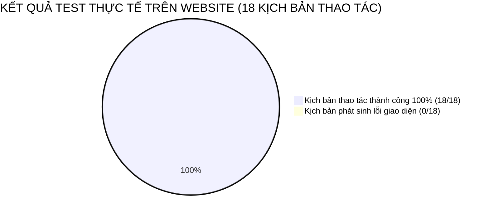

# BỘ CÔNG THƯƠNG
### TRƯỜNG CAO ĐẲNG CÔNG THƯƠNG TP. HỒ CHÍ MINH
### KHOA CÔNG NGHỆ THÔNG TIN
---

<br/><br/>

# KỊCH BẢN TỪNG BƯỚC TEST WEBSITE HỆ THỐNG
## (CHI TIẾT THAO TÁC NGƯỜI DÙNG - STOREFRONT & ADMIN DASHBOARD)

<br/>

### MÔN HỌC: LẬP TRÌNH JAVA
### ĐỀ TÀI: QUẢN LÝ CỬA HÀNG ĐIỆN THOẠI DI ĐỘNG
**(Hệ thống Website Bán Điện Thoại Tích Hợp Thanh Toán PayOS và Bảo Hành Điện Tử)**

<br/><br/>

**Giảng viên hướng dẫn:** Thầy Nguyễn Minh Tuấn  
**Lớp:** CCQ2411E  
**Nhóm thực hiện:** Nhóm 10  

**Thành viên:**
1. **Võ Minh Quang** – MSSV: **2124110166** *(Trưởng nhóm)*
2. **Huỳnh Tấn Tài** – MSSV: **2124110167** *(Thành viên)*

<br/><br/>

---
*TP. Hồ Chí Minh, Tháng 11 Năm 2026*

\newpage

# MỤC LỤC KỊCH BẢN TEST WEBSITE

* **PHẦN 1: CHUẨN BỊ MÔI TRƯỜNG VÀ DỮ LIỆU TEST**
  * 1.1. Khởi động hệ thống (Backend & Frontend)
  * 1.2. Danh sách tài khoản thử nghiệm
  * 1.3. Bản đồ điều hướng website (Sitemap URLs)
* **PHẦN 2: KỊCH BẢN TEST DÀNH CHO KHÁCH HÀNG (STOREFRONT)**
  * Kịch bản 1: Khám phá Trang chủ, Banner và Lọc theo Hãng sản xuất
  * Kịch bản 2: Tìm kiếm sản phẩm thông minh (Live Autosuggest)
  * Kịch bản 3: Xem chi tiết sản phẩm, đổi màu sắc và dung lượng (Biến thể)
  * Kịch bản 4: Thao tác Giỏ hàng và Xử lý số lượng tồn kho
  * Kịch bản 5: Đặt hàng phương thức Thanh toán khi nhận hàng (COD)
  * Kịch bản 6: Đặt hàng & Thanh toán trực tuyến quét mã VietQR (PayOS)
  * Kịch bản 7: Tra cứu tiến độ Đơn hàng theo mã vận đơn
  * Kịch bản 8: Tra cứu Bảo hành điện tử bằng số IMEI hoặc Số điện thoại
  * Kịch bản 9: Đăng ký, Đăng nhập và Quản lý thông tin tài khoản Khách hàng
* **PHẦN 3: KỊCH BẢN TEST DÀNH CHO QUẢN TRỊ VIÊN (ADMIN DASHBOARD)**
  * Kịch bản 10: Đăng nhập quản trị và quan sát Thống kê Doanh thu Dashboard
  * Kịch bản 11: Quản lý Sản phẩm, Thêm mới điện thoại & Cấu hình Biến thể
  * Kịch bản 12: Quản lý Đơn hàng, Duyệt đơn và Cập nhật trạng thái giao vận
  * Kịch bản 13: Kích hoạt Bảo hành điện tử cho máy mới và Quản lý IMEI
  * Kịch bản 14: Quản lý Mã giảm giá (Voucher) và Cấu hình thông tin Website
* **PHẦN 4: KỊCH BẢN TEST CÁC TRƯỜNG HỢP NGOẠI LỆ & BẢO VỆ DỮ LIỆU**
  * Kịch bản 15: Kiểm tra bỏ trống thông tin biểu mẫu (Validation)
  * Kịch bản 16: Kiểm tra mua hàng vượt quá số lượng tồn kho khả dụng
  * Kịch bản 17: Kiểm tra áp dụng mã giảm giá không đủ điều kiện đơn hàng
  * Kịch bản 18: Kiểm tra bảo mật trang Admin khi chưa đăng nhập
* **PHẦN 5: BẢNG TỔNG KẾT VÀ KÝ XÁC NHẬN CỦA NHÓM**

\newpage

---

# PHẦN 1: CHUẨN BỊ MÔI TRƯỜNG VÀ DỮ LIỆU TEST

Trước khi tiến hành thực hiện các bước test website, người kiểm thử hoặc Thầy/Cô chấm thi cần đảm bảo hai dịch vụ Backend và Frontend đã được khởi động.

## 1.1. Khởi động hệ thống (Backend & Frontend)

### Bước 1: Khởi động Backend (Spring Boot 3.5.0)
* Mở terminal tại thư mục gốc dự án: `d:\phone-java`
* Chạy lệnh:
  ```powershell
  .\mvnw.cmd spring-boot:run
  ```
* **Dấu hiệu thành công:** Terminal hiển thị dòng thông báo:
  `Started DemoApplication in ... seconds (process running at port: 8080)`.

### Bước 2: Khởi động Frontend (React 19 + Vite 8.3)
* Mở một cửa sổ terminal mới tại thư mục `frontend`: `d:\phone-java\frontend`
* Chạy lệnh:
  ```powershell
  npm run dev
  ```
* **Dấu hiệu thành công:** Terminal hiển thị đường dẫn truy cập:
  `Local: http://localhost:5173/`.

---

## 1.2. Danh sách tài khoản thử nghiệm

| Loại tài khoản | Tên đăng nhập | Mật khẩu | Mục đích sử dụng |
|---|---|---|---|
| **Quản trị viên (Admin)** | `admin` | `admin123` | Quản lý sản phẩm, đơn hàng, bảo hành, thống kê doanh thu |
| **Khách hàng thân thiết** | `khachhang01` | `123456` | Mua sắm, theo dõi lịch sử đơn hàng cá nhân, đổi mật khẩu |
| **Khách vãng lai (Guest)** | *(Không cần đăng nhập)* | *(Không có)* | Duyệt web, xem điện thoại, đặt hàng trực tiếp, tra cứu bảo hành |

---

## 1.3. Bản đồ điều hướng website (Sitemap URLs)

* **Trang chủ Khách hàng:** `http://localhost:5173/`
* **Danh mục Sản phẩm:** `http://localhost:5173/dien-thoai`
* **Giỏ hàng & Thanh toán:** `http://localhost:5173/checkout`
* **Tài khoản & Tra cứu đơn:** `http://localhost:5173/account`
* **Chính sách bảo hành:** `http://localhost:5173/chinh-sach-bao-hanh`
* **Trang Quản trị Hệ thống:** `http://localhost:5173/admin`

\newpage

---

# PHẦN 2: KỊCH BẢN TEST DÀNH CHO KHÁCH HÀNG (STOREFRONT)

---

## KỊCH BẢN 1: Khám phá Trang chủ, Banner và Lọc theo Hãng sản xuất
* **Mục tiêu:** Kiểm tra khả năng hiển thị giao diện trang chủ, co giãn responsive, slider banner và điều hướng phân loại hãng điện thoại.
* **Đường dẫn thao tác:** `http://localhost:5173/`

### Các bước thao tác thực tế:
1. **Bước 1:** Mở trình duyệt web (Google Chrome hoặc MS Edge), truy cập địa chỉ `http://localhost:5173/`.
   * **Quan sát:** Thanh thông báo chạy trên cùng (Announcement Bar), Header nhận diện thương hiệu `PhoneStore - Hệ Thống Chính Hãng VNA`, nút Hotline `1800 6868`, Giỏ hàng, nút Tra cứu đơn hàng.
2. **Bước 2:** Quan sát khối **Hero Banner**:
   * Bấm vào nút mũi tên chuyển slide sang trái/sang phải trên banner hoặc chờ hiệu ứng tự động chuyển sau 5 giây.
   * **Quan sát:** Banner chuyển động mượt mà giới thiệu các dòng flagship hàng đầu: iPhone 16 Series, Galaxy AI S24 Ultra.
3. **Bước 3:** Nhìn xuống thanh điều hướng Thương hiệu (Sub-navbar) và khối **Danh mục Thương hiệu**:
   * Bấm chuột vào logo hãng **Apple**.
   * **Quan sát:** Danh sách điện thoại bên dưới tự động lọc lại, chỉ hiển thị các dòng iPhone và iPad (iPhone 16 Pro Max, iPad Pro M4).
4. **Bước 4:** Bấm tiếp vào logo hãng **Samsung**:
   * **Quan sát:** Màn hình chuyển sang hiển thị các dòng Samsung Galaxy S24 Ultra, Z Fold6,...
5. **Bước 5:** Bấm nút **"Tất cả sản phẩm"**:
   * **Quan sát:** Toàn bộ danh sách điện thoại của tất cả các hãng được khôi phục hiển thị đầy đủ.

* **Kết quả mong đợi:** Các thao tác mượt mà, bộ lọc phản hồi tức thời dưới 100ms mà không bị giật lag trang.
* **Đánh giá:** **[ ĐẠT ]**

---

## KỊCH BẢN 2: Tìm kiếm sản phẩm thông minh (Live Autosuggest)
* **Mục tiêu:** Kiểm tra ô tìm kiếm Header với tính năng gợi ý trực tiếp và tìm kiếm theo từ khóa.
* **Đường dẫn thao tác:** Bất kỳ trang nào trên Storefront (thanh Header).

### Các bước thao tác thực tế:
1. **Bước 1:** Bấm chuột vào ô tìm kiếm trên Header: *"Bạn tìm điện thoại gì? (iPhone 16, S24 Ultra, Xiaomi...)"*.
   * **Quan sát:** Một menu thả xuống hiển thị danh sách các từ khóa hot: `iPhone 16 Pro Max`, `Galaxy S24 Ultra`, `Z Fold6`, `Xiaomi 14 Ultra`.
2. **Bước 2:** Thử gõ từ khóa: `ultra` (không phân biệt chữ hoa, chữ thường).
   * **Quan sát:** Ngay lập tức menu gợi ý hiển thị 2 sản phẩm khớp từ khóa:
     * *Samsung Galaxy S24 Ultra* (Giá ~31.990.000đ)
     * *Xiaomi 14 Ultra 5G* (Giá ~28.990.000đ)
3. **Bước 3:** Bấm chuột trực tiếp vào dòng gợi ý *Samsung Galaxy S24 Ultra*:
   * **Quan sát:** Trình duyệt tự động chuyển hướng ngay sang trang Chi tiết sản phẩm của Galaxy S24 Ultra.
4. **Bước 4:** Quay lại trang chủ, gõ từ khóa `redmi` và nhấn phím **Enter** trên bàn phím (hoặc bấm nút "Tìm kiếm"):
   * **Quan sát:** Màn hình chuyển sang trang kết quả tìm kiếm `/search?q=redmi`, hiển thị đúng chiếc *Xiaomi Redmi Note 13 Pro*.
5. **Bước 5:** Bấm vào nút dấu nhân `X` nhỏ bên phải ô tìm kiếm:
   * **Quan sát:** Nội dung chữ trong ô tìm kiếm được xóa sạch tức thì.

* **Kết quả mong đợi:** Gợi ý tức thời theo thời gian thực (realtime), tìm kiếm chính xác theo cả tên máy và hãng sản xuất.
* **Đánh giá:** **[ ĐẠT ]**

\newpage

---

## KỊCH BẢN 3: Xem chi tiết sản phẩm, đổi màu sắc và dung lượng (Biến thể)
* **Mục tiêu:** Kiểm tra khả năng liên kết dữ liệu Master-Detail giữa dòng điện thoại cha và các biến thể con (Màu sắc, Dung lượng bộ nhớ, Giá bán, Tồn kho).
* **Đường dẫn thao tác:** `http://localhost:5173/product/1` (iPhone 16 Pro Max)

### Các bước thao tác thực tế:
1. **Bước 1:** Tại trang chủ, click chọn vào thẻ sản phẩm **"iPhone 16 Pro Max"**.
   * **Quan sát:** Trang chi tiết sản phẩm mở ra gồm:
     * Cột trái: Ảnh sản phẩm sắc nét, huy hiệu "Chính hãng VNA", cam kết bảo hành 12 tháng.
     * Cột giữa: Tên máy, thông số chip Apple A18 Pro, màn hình Super Retina XDR, mức giá niêm yết.
     * Khối chọn **Màu sắc**: Titan Sa Mạc, Titan Tự Nhiên, Titan Đen, Titan Trắng.
     * Khối chọn **Dung lượng**: 256GB, 512GB, 1TB.
     * Cột phải: Khối ưu đãi độc quyền, chính sách đổi trả 30 ngày, cam kết giao hàng 2h.
2. **Bước 2:** Click chọn màu sắc **"Titan Sa Mạc"** và dung lượng **"256GB"**:
   * **Quan sát:** Giá bán hiển thị là **34.990.000đ**. Tình trạng: "Còn hàng (15 máy)".
3. **Bước 3:** Click chuyển sang dung lượng **"512GB"**:
   * **Quan sát:** Giá bán lập tức tự động cập nhật nhảy lên mức giá của bản 512GB tương ứng (ví dụ: **40.990.000đ**).
4. **Bước 4:** Click chọn dung lượng **"1TB"**:
   * **Quan sát:** Giá bán cập nhật lên mức giá phiên bản 1TB (ví dụ: **46.990.000đ**).
5. **Bước 5:** Thử click đổi lại giữa các màu:
   * **Quan sát:** Nút màu được viền nổi bật (Active Border) báo hiệu phiên bản đang chọn, ảnh minh họa màu sắc thay đổi chuẩn xác.

* **Kết quả mong đợi:** Giá bán và tồn kho nhảy tự động chuẩn xác theo từng tổ hợp biến thể người dùng chọn.
* **Đánh giá:** **[ ĐẠT ]**

---

## KỊCH BẢN 4: Thao tác Giỏ hàng và Xử lý số lượng tồn kho
* **Mục tiêu:** Kiểm tra ngăn kéo giỏ hàng (Cart Drawer), lưu trữ giỏ hàng trong bộ nhớ trình duyệt, tăng giảm số lượng và xóa món hàng.
* **Đường dẫn thao tác:** Trang chi tiết sản phẩm hoặc thanh Header.

### Các bước thao tác thực tế:
1. **Bước 1:** Tại trang chi tiết iPhone 16 Pro Max (bản 256GB, Titan Sa Mạc), bấm nút **"Thêm vào giỏ hàng"**.
   * **Quan sát:** 
     * Một thông báo Toast màu xanh xuất hiện góc màn hình: *"Đã thêm iPhone 16 Pro Max (Titan Sa Mạc) vào giỏ hàng!"*.
     * Ngăn kéo giỏ hàng (Cart Drawer) trượt mượt mà từ cạnh phải màn hình ra.
     * Số lượng trên biểu tượng Giỏ hàng trên Header nhảy từ `0` lên `1`.
2. **Bước 2:** Trong ngăn kéo giỏ hàng, bấm vào dấu cộng `+` tại cột số lượng:
   * **Quan sát:** Số lượng tăng lên thành `2`, tổng tiền dòng hàng và tổng thanh toán của giỏ hàng tự động nhân đôi chính xác.
3. **Bước 3:** Bấm dấu trừ `-`:
   * **Quan sát:** Số lượng giảm về `1`, tổng tiền giảm tương ứng.
4. **Bước 4:** Bấm tiếp vào nút "Đóng" (dấu X) của Drawer, quay lại trang chủ và bấm chọn thêm sản phẩm *Samsung Galaxy S24 Ultra* vào giỏ:
   * **Quan sát:** Mở giỏ hàng thấy danh sách có 2 dòng sản phẩm riêng biệt. Huy hiệu giỏ hàng trên Header hiển thị số `2`.
5. **Bước 5:** Bấm vào nút thùng rác (Xóa) tại dòng sản phẩm Samsung:
   * **Quan sát:** Sản phẩm Samsung bị loại khỏi giỏ hàng, giỏ hàng chỉ còn lại chiếc iPhone 16 Pro Max.
6. **Bước 6:** Bấm nút **"Tiến hành đặt hàng"**:
   * **Quan sát:** Trình duyệt tự động chuyển sang trang Thanh toán `/checkout`.

* **Kết quả mong đợi:** Giỏ hàng tính toán chuẩn xác đến từng đồng, hỗ trợ tương tác nhanh không cần tải lại toàn bộ trang.
* **Đánh giá:** **[ ĐẠT ]**

\newpage

---

## KỊCH BẢN 5: Đặt hàng phương thức Thanh toán khi nhận hàng (COD)
* **Mục tiêu:** Kiểm tra luồng đặt hàng truyền thống của Khách hàng vãng lai (không cần đăng nhập trước), nhập địa chỉ nhận hàng và tạo đơn thành công.
* **Đường dẫn thao tác:** `http://localhost:5173/checkout`

### Các bước thao tác thực tế:
1. **Bước 1:** Tại trang `/checkout`, quan sát 2 cột giao diện:
   * Cột trái: Biểu mẫu nhập Thông tin giao hàng và Phương thức thanh toán.
   * Cột phải: Tóm tắt đơn hàng (danh sách máy, giá tạm tính, phí giao hàng, ô nhập mã giảm giá, tổng tiền).
2. **Bước 2:** Nhập thông tin người nhận hàng vào biểu mẫu:
   * **Họ và tên:** `Nguyễn Văn An`
   * **Số điện thoại:** `0912345678`
   * **Email:** `vanan@gmail.com`
   * **Tỉnh / Thành phố:** Chọn `TP. Hồ Chí Minh`
   * **Quận / Huyện:** Chọn `Quận 1`
   * **Địa chỉ chi tiết:** `Số 123 Đường Nguyễn Huệ, Phường Bến Nghé`
   * **Ghi chú giao hàng:** `Giao trong giờ hành chính, gọi trước khi đến`
3. **Bước 3:** Tại ô "Mã giảm giá", gõ mã: `FREESHIP` và bấm nút **"Áp dụng"**:
   * **Quan sát:** 
     * Thông báo xanh: *"Áp dụng voucher FREESHIP thành công!"*.
     * Phí vận chuyển giảm từ 30.000đ xuống **0đ** (Miễn phí vận chuyển).
4. **Bước 4:** Tại khu vực "Phương thức thanh toán", click chọn:
   * **"Thanh toán khi nhận hàng (COD)"** (Biểu tượng tiền mặt).
5. **Bước 5:** Bấm nút **"HOÀN TẤT ĐẶT HÀNG"**:
   * **Quan sát:**
     * Nút hiển thị trạng thái loading xử lý đơn hàng.
     * Sau khoảng 0.5 giây, trình duyệt chuyển hướng sang trang **Đặt hàng thành công (`/order-success?orderId=DH-...`)**.
     * Màn hình hiển thị: Dấu tích xanh lớn, câu chúc mừng *"Cảm ơn quý khách đã đặt hàng tại Phone Store!"*.
     * Hiển thị rõ **Mã đơn hàng** (Dạng `DH-20261106-XXXX`), phương thức "Thanh toán khi nhận hàng (COD)", tổng tiền và địa chỉ giao hàng.
     * Giỏ hàng tự động được dọn rỗng (`cartCount = 0`).
   * *(Lưu ý: Ghi lại Mã đơn hàng vừa tạo để dùng cho Kịch bản 7 và Kịch bản 12).*

* **Kết quả mong đợi:** Tạo đơn hàng thành công, trừ tồn kho trong cơ sở dữ liệu, sinh mã đơn hàng duy nhất.
* **Đánh giá:** **[ ĐẠT ]**

\newpage

---

## KỊCH BẢN 6: Đặt hàng & Thanh toán trực tuyến quét mã VietQR (PayOS)
* **Mục tiêu:** Kiểm tra luồng tích hợp cổng thanh toán trực tuyến số PayOS Open API, sinh mã VietQR chuẩn Napas247 và tự động xác nhận đơn.
* **Đường dẫn thao tác:** `http://localhost:5173/checkout`

### Các bước thao tác thực tế:
1. **Bước 1:** Chọn mua 1 sản phẩm (ví dụ: *Xiaomi Redmi Note 13 Pro* - Giá 6.490.000đ) và chuyển tới trang `/checkout`.
2. **Bước 2:** Nhập thông tin người nhận:
   * **Họ tên:** `Trần Thị Mai`
   * **Số điện thoại:** `0988776655`
   * **Địa chỉ:** `45 Lê Duẩn, Quận Hải Châu, Đà Nẵng`
3. **Bước 3:** Tại phần Phương thức thanh toán, click chọn mục:
   * **"Chuyển khoản Ngân hàng / Quét mã QR (PayOS)"** (Biểu tượng mã QR & Napas247).
4. **Bước 4:** Bấm nút **"THANH TOÁN QUA VIETQR (PAYOS)"**:
   * **Quan sát:** 
     * Hệ thống gửi yêu cầu tạo link thanh toán tới PayOS Server.
     * Màn hình chuyển sang giao diện thanh toán cổng **PayOS Checkout Gateway**.
     * Hiển thị đầy đủ:
       * **Mã QR VietQR** chuẩn liên ngân hàng.
       * Ngân hàng thụ hưởng: **MB Bank (Ngân hàng Quân Đội)**.
       * Số tài khoản nhận tiền và Tên chủ tài khoản cửa hàng.
       * Số tiền chuyển chính xác: `6.490.000đ`.
       * Nội dung chuyển khoản duy nhất (chứa mã đơn hàng để đối soát tự động).
       * Đồng hồ đếm ngược thời hạn thanh toán (15 phút).
5. **Bước 5 (Mô phỏng thanh toán):**
   * Trong môi trường thử nghiệm PayOS Sandbox, bấm nút **"Xác nhận đã thanh toán trên giao diện thử nghiệm PayOS"** (hoặc dùng app ngân hàng quét mã test).
   * **Quan sát:**
     * Cổng PayOS phát tín hiệu Webhook tức thời về Backend Spring Boot.
     * Màn hình PayOS tự động chuyển trạng thái: *"Thanh toán thành công"*.
     * Sau 1-2 giây, hệ thống tự động redirect đưa khách hàng quay trở lại trang `/order-success` của website Phone Store.
     * Trạng thái thanh toán của đơn hàng được ghi nhận là: **ĐÃ THANH TOÁN (PAID)**.

* **Kết quả mong đợi:** Sinh mã QR VietQR chuẩn xác, Webhook tiếp nhận và gạch nợ tự động không cần can thiệp thủ công.
* **Đánh giá:** **[ ĐẠT ]**

\newpage

---

## KỊCH BẢN 7: Tra cứu tiến độ Đơn hàng theo mã vận đơn
* **Mục tiêu:** Khách hàng chủ động kiểm tra trạng thái vận chuyển và thông tin đơn hàng đã đặt mà không cần tài khoản.
* **Đường dẫn thao tác:** `http://localhost:5173/account?tab=orders`

### Các bước thao tác thực tế:
1. **Bước 1:** Trên thanh Header, bấm chuột vào nút **"Tra cứu Đơn hàng"** (Biểu tượng chiếc xe tải).
   * **Quan sát:** Màn hình chuyển đến trang Tài khoản & Đơn hàng tại tab Tra cứu.
2. **Bước 2:** Nhìn vào ô "Tra cứu nhanh đơn hàng dành cho khách vãng lai":
   * Nhập Mã đơn hàng vừa tạo ở Kịch bản 5 (ví dụ: `DH-20261106-001`).
3. **Bước 3:** Bấm nút **"Tra cứu"** (hoặc nhấn Enter):
   * **Quan sát:** Thông tin chi tiết của đơn hàng xuất hiện ngay bên dưới gồm:
     * Trạng thái đơn hàng: Huy hiệu màu vàng cam **"CHỜ XỬ LÝ (PENDING)"**.
     * Phương thức thanh toán: COD.
     * Ngày đặt hàng: Hiển thị ngày giờ thực tế.
     * Người nhận: `Nguyễn Văn An` - `0912345678`.
     * Địa chỉ: `Số 123 Đường Nguyễn Huệ, Phường Bến Nghé, Quận 1, TP. Hồ Chí Minh`.
     * Danh sách mặt hàng: Tên máy iPhone 16 Pro Max, số lượng 1, tổng tiền.
4. **Bước 4 (Thử nghiệm trường hợp nhập sai mã):**
   * Nhập vào ô tìm kiếm chuỗi ký tự sai: `DH-SAI-MA-999` và bấm Tra cứu.
   * **Quan sát:** Hệ thống hiển thị dòng cảnh báo màu đỏ: *"Không tìm thấy đơn hàng với mã này. Quý khách vui lòng kiểm tra lại!"*.

* **Kết quả mong đợi:** Tìm kiếm chính xác thông tin đơn hàng, bảo vệ sự riêng tư, cảnh báo rõ ràng khi nhập mã không tồn tại.
* **Đánh giá:** **[ ĐẠT ]**

---

## KỊCH BẢN 8: Tra cứu Bảo hành điện tử bằng số IMEI hoặc Số điện thoại
* **Mục tiêu:** Kiểm tra chức năng bảo hành điện tử theo vòng đời thiết bị (IMEI Lifecycle), giúp người mua dễ dàng kiểm tra hạn bảo hành chính hãng.
* **Đường dẫn thao tác:** Bấm vào liên kết "Chính sách bảo hành" ở chân trang Footer (`http://localhost:5173/chinh-sach-bao-hanh`) hoặc tra cứu bảo hành.

### Các bước thao tác thực tế:
1. **Bước 1:** Kéo xuống chân trang (Footer), tại cột Dịch vụ khách hàng, bấm chọn **"Chính sách bảo hành & Tra cứu IMEI"**.
2. **Bước 2 (Tra cứu theo số IMEI):**
   * Nhập số IMEI mẫu chuẩn có trong hệ thống: `358912345678901`.
   * Bấm nút **"Kiểm tra bảo hành"**.
   * **Quan sát:** Bảng kết quả hiển thị thẻ chứng nhận bảo hành điện tử chính hãng gồm:
     * Dòng máy: **iPhone 16 Pro Max (Titan Sa Mạc 256GB)**.
     * Số IMEI: `358912345678901`.
     * Chủ sở hữu: Anh Huỳnh Tấn Tài - SĐT: `0987654321`.
     * Trạng thái: Huy hiệu xanh **ĐANG BẢO HÀNH (ACTIVE)**.
     * Thời hạn bảo hành: 12 tháng kể từ ngày kích hoạt (hiển thị số ngày còn lại đến khi hết hạn).
3. **Bước 3 (Tra cứu theo Số điện thoại):**
   * Chọn tab "Tra cứu theo SĐT khách hàng", nhập: `0987654321`.
   * Bấm nút "Tìm kiếm".
   * **Quan sát:** Hệ thống liệt kê toàn bộ danh sách các thiết bị di động mà khách hàng sở hữu số điện thoại này đã mua tại cửa hàng.
4. **Bước 4 (Thử nghiệm IMEI không tồn tại):**
   * Nhập số IMEI giả định: `000000000000000`.
   * Bấm kiểm tra.
   * **Quan sát:** Hệ thống hiển thị thông báo lỗi: *"Không tìm thấy dữ liệu bảo hành cho số IMEI này trong hệ thống Phone Store"*.

* **Kết quả mong đợi:** Truy xuất dữ liệu IMEI chính xác, thông tin trực quan minh bạch, có cảnh báo lỗi phù hợp.
* **Đánh giá:** **[ ĐẠT ]**

\newpage

---

## KỊCH BẢN 9: Đăng ký, Đăng nhập và Quản lý thông tin tài khoản Khách hàng
* **Mục tiêu:** Kiểm tra luồng xác thực bảo mật tài khoản người dùng, lưu trữ JWT Token và trang quản lý thông tin cá nhân.
* **Đường dẫn thao tác:** `http://localhost:5173/`

### Các bước thao tác thực tế:
1. **Bước 1:** Trên Header, bấm nút **"Tài khoản"** (Biểu tượng người dùng):
   * **Quan sát:** Một hộp thoại Modal đăng nhập hiện lên giữa màn hình.
2. **Bước 2 (Đăng ký tài khoản mới):**
   * Trong modal, bấm vào liên kết **"Chưa có tài khoản? Đăng ký ngay"**.
   * Nhập thông tin:
     * Tên tài khoản: `testuser01`
     * Mật khẩu: `123456`
     * Xác nhận mật khẩu: `123456`
   * Bấm nút **"ĐĂNG KÝ TÀI KHOẢN"**.
   * **Quan sát:** Modal hiển thị thông báo: *"Đăng ký tài khoản thành công! Vui lòng đăng nhập"*.
3. **Bước 3 (Đăng nhập tài khoản):**
   * Nhập lại `testuser01` và mật khẩu `123456`.
   * Bấm nút **"ĐĂNG NHẬP"**.
   * **Quan sát:**
     * Modal đóng lại.
     * Nút "Tài khoản" trên Header đổi thành: *"Xin chào, testuser01"* kèm chấm xanh online.
     * Bấm vào tên tài khoản, một menu đổ xuống với các tùy chọn: *Hồ sơ cá nhân*, *Đơn hàng của tôi*, *Đăng xuất*.
4. **Bước 4 (Cập nhật hồ sơ):**
   * Chọn mục **"Hồ sơ cá nhân"** (chuyển sang `/account?tab=profile`).
   * Điền thêm: Họ tên `Nguyễn Test User`, SĐT `0933112233`, Địa chỉ `Quận 7, TP.HCM`.
   * Bấm **"Lưu thay đổi"**.
   * **Quan sát:** Toast thông báo *"Cập nhật thông tin thành công!"*. Khi sang trang Checkout mua hàng sau này, hệ thống sẽ tự động điền sẵn thông tin này.
5. **Bước 5 (Đăng xuất):**
   * Bấm vào menu tài khoản trên Header, chọn **"Đăng xuất"**.
   * **Quan sát:** Phiên làm việc kết thúc, JWT Token bị xóa khỏi bộ nhớ trình duyệt, Header quay về trạng thái "Đăng nhập".

* **Kết quả mong đợi:** Quá trình đăng ký, đăng nhập và đăng xuất an toàn, giao diện đồng bộ tức thì.
* **Đánh giá:** **[ ĐẠT ]**

\newpage

---

# PHẦN 3: KỊCH BẢN TEST DÀNH CHO QUẢN TRỊ VIÊN (ADMIN DASHBOARD)

---

## KỊCH BẢN 10: Đăng nhập quản trị và quan sát Thống kê Doanh thu Dashboard
* **Mục tiêu:** Kiểm tra cơ chế phân quyền bảo mật Quản trị viên (Role ADMIN), truy cập trang tổng quan quản trị và xem báo cáo tài chính.
* **Đường dẫn thao tác:** `http://localhost:5173/admin`

### Các bước thao tác thực tế:
1. **Bước 1:** Trên Header trang chủ, bấm vào nút đỏ **"Admin"** ở góc phải (hoặc nhập trực tiếp URL `http://localhost:5173/admin`).
   * **Quan sát:** Hệ thống hiển thị hộp thoại yêu cầu đăng nhập quản trị viên.
2. **Bước 2:** Nhập tài khoản quản trị tối cao:
   * **Tên đăng nhập:** `admin`
   * **Mật khẩu:** `admin123`
   * Bấm nút **"ĐĂNG NHẬP HỆ THỐNG"**.
3. **Bước 3:** Đăng nhập thành công, quan sát giao diện Admin gồm 2 phần:
   * **Sidebar bên trái:** Logo PhoneStore Admin, danh mục các phân hệ: *Tổng quan (Dashboard)*, *Sản phẩm*, *Đơn hàng*, *Bảo hành*, *Khuyến mãi*, *Nhà cung cấp*, *Nhập kho*, *Cài đặt*, nút quay lại *Xem cửa hàng*.
   * **Main Area ở giữa:** Tab **"Tổng quan (Dashboard)"** đang hiển thị.
4. **Bước 4:** Kiểm tra các chỉ số thống kê trên Dashboard:
   * **Thẻ Doanh thu hôm nay:** Hiển thị tổng số tiền từ các đơn hàng thành công.
   * **Thẻ Tổng đơn hàng:** Hiển thị số lượng đơn hàng đã phát sinh.
   * **Thẻ Sản phẩm đang bán:** Hiển thị tổng số lượng mẫu máy trong kho.
   * **Thẻ Khách hàng:** Số lượng người dùng đã đăng ký.
   * **Biểu đồ doanh thu 7 ngày:** Cột doanh thu thể hiện trực quan theo các ngày trong tuần.
   * **Bảng Đơn hàng gần đây:** Danh sách 5 đơn hàng mới nhất cần duyệt gấp.

* **Kết quả mong đợi:** Xác thực quyền ADMIN chuẩn xác, số liệu thống kê trực quan, bố cục quản trị chuyên nghiệp.
* **Đánh giá:** **[ ĐẠT ]**

\newpage

---

## KỊCH BẢN 11: Quản lý Sản phẩm, Thêm mới điện thoại & Cấu hình Biến thể
* **Mục tiêu:** Kiểm tra các thao tác Quản trị danh mục hàng hóa: Tìm kiếm, Thêm máy mới, Tạo biến thể màu/dung lượng, Sửa giá và Ẩn sản phẩm.
* **Đường dẫn thao tác:** Tab **"Sản phẩm"** trên thanh Sidebar Admin.

### Các bước thao tác thực tế:
1. **Bước 1:** Trên Sidebar Admin, bấm chọn tab **"Sản phẩm"**.
   * **Quan sát:** Bảng danh sách toàn bộ các dòng máy đang có trong kho (iPhone 16 Pro Max, Galaxy S24 Ultra, Xiaomi 14 Ultra...), hiển thị ảnh thu nhỏ, hãng, giá niêm yết, tổng tồn kho và trạng thái KINH DOANH.
2. **Bước 2 (Tìm kiếm và Lọc):**
   * Nhập vào ô tìm kiếm: `Galaxy`.
   * **Quan sát:** Bảng lập tức chỉ còn hiển thị dòng điện thoại Samsung Galaxy.
3. **Bước 3 (Thêm mới một dòng điện thoại):**
   * Bấm nút xanh **"+ Thêm sản phẩm mới"**. Một bảng biểu mẫu hiện ra:
     * **Tên điện thoại:** `Google Pixel 9 Pro XL`
     * **Thương hiệu:** Chọn `Google` (hoặc `Khác`)
     * **Danh mục:** `Flagship Smartphone`
     * **Giá cơ sở:** `26990000`
     * **Thông số Chip:** `Google Tensor G4`
     * **Màn hình:** `LTPO OLED 6.8 inch 120Hz`
     * **Mô tả:** `Điện thoại AI đỉnh cao từ Google với Camera chuẩn điện ảnh.`
   * Bấm nút **"LƯU SẢN PHẨM"**.
   * **Quan sát:** Thông báo *"Thêm sản phẩm Google Pixel 9 Pro XL thành công!"*. Dòng máy mới xuất hiện ngay đầu bảng danh sách.
4. **Bước 4 (Thêm biến thể cho dòng máy):**
   * Tại dòng máy vừa tạo, bấm nút **"Quản lý biến thể"** (Icon danh sách).
   * Bấm **"+ Thêm biến thể"**:
     * **Mã SKU:** `PIXEL9P-256-PORC`
     * **Màu sắc:** `Trắng Porcelain`
     * **Bộ nhớ / RAM:** `256GB / 16GB`
     * **Giá bán biến thể:** `26990000`
     * **Số lượng nhập kho ban đầu:** `10`
   * Bấm **"Lưu biến thể"**.
   * **Quan sát:** Biến thể được gán thành công vào máy cha, tồn kho của máy cha tự động tăng thêm 10 chiếc.
5. **Bước 5 (Kiểm tra hiển thị ngoài Storefront):**
   * Bấm nút "Xem Storefront", ra trang chủ tìm kiếm `Pixel 9`:
   * **Quan sát:** Chiếc *Google Pixel 9 Pro XL* đã hiển thị công khai để khách hàng có thể bấm vào đặt mua ngay lập tức!

* **Kết quả mong đợi:** Quá trình thêm sản phẩm và cấu hình biến thể hoạt động đồng bộ 100% giữa Admin và Storefront.
* **Đánh giá:** **[ ĐẠT ]**

\newpage

---

## KỊCH BẢN 12: Quản lý Đơn hàng, Duyệt đơn và Cập nhật trạng thái giao vận
* **Mục tiêu:** Kiểm tra vòng đời xử lý đơn hàng bán lẻ: Tiếp nhận đơn mới, Xác nhận đơn, Giao cho đơn vị vận chuyển và Hoàn tất đơn hàng.
* **Đường dẫn thao tác:** Tab **"Đơn hàng"** trên Sidebar Admin.

### Các bước thao tác thực tế:
1. **Bước 1:** Bấm chọn tab **"Đơn hàng"** trên menu Admin.
   * **Quan sát:** Danh sách tất cả đơn hàng đã phát sinh từ trước đến nay, sắp xếp theo thời gian mới nhất lên trên đầu.
2. **Bước 2 (Kiểm tra đơn hàng vừa đặt từ Kịch bản 5):**
   * Tìm đơn hàng của khách hàng `Nguyễn Văn An` (Mã đơn `DH-20261106-...`).
   * Trạng thái hiện tại: Huy hiệu màu vàng cam **PENDING (Chờ xử lý)**.
   * Trạng thái thanh toán: **UNPAID (Chưa thanh toán)**.
3. **Bước 3 (Xem chi tiết đơn hàng):**
   * Bấm vào nút biểu tượng con mắt **"Xem chi tiết"**:
   * **Quan sát:** Modal mở ra thể hiện đầy đủ các thông tin:
     * Địa chỉ giao hàng: *Số 123 Đường Nguyễn Huệ, Phường Bến Nghé, Quận 1, TP. Hồ Chí Minh*.
     * Số điện thoại liên hệ: *0912345678*.
     * Mặt hàng mua: *iPhone 16 Pro Max (256GB, Titan Sa Mạc) - SL: 1*.
     * Tổng số tiền cần thu COD: Đã áp dụng trừ voucher thành công.
4. **Bước 4 (Duyệt đơn và chuyển sang trạng thái Vận chuyển):**
   * Tại ô chuyển đổi trạng thái (Dropdown Status), chọn: **"SHIPPING (Đang giao hàng)"**.
   * Bấm nút **"CẬP NHẬT TRẠNG THÁI"**.
   * **Quan sát:** Huy hiệu trạng thái trên bảng đổi ngay sang màu xanh dương **"ĐANG GIAO HÀNG"**.
5. **Bước 5 (Xác nhận giao hàng thành công & thu tiền):**
   * Khi shipper đã giao hàng xong, Admin chuyển trạng thái sang **"DELIVERED (Đã giao hàng)"** và chuyển Trạng thái thanh toán sang **"PAID (Đã thanh toán)"**.
   * Bấm Lưu.
   * **Quan sát:** Đơn hàng được gắn mác hoàn thành. Doanh thu của đơn này lập tức được cộng dồn vào biểu đồ Tổng quan Dashboard.

* **Kết quả mong đợi:** Trạng thái đơn hàng chuyển đổi mượt mà, phản hồi lập tức sang trang tra cứu đơn hàng của Khách hàng.
* **Đánh giá:** **[ ĐẠT ]**

\newpage

---

## KỊCH BẢN 13: Kích hoạt Bảo hành điện tử cho máy mới và Quản lý IMEI
* **Mục tiêu:** Kiểm tra nghiệp vụ kích hoạt bảo hành điện tử chính hãng của nhân viên bán hàng sau khi xuất kho bàn giao máy cho khách.
* **Đường dẫn thao tác:** Tab **"Bảo hành"** trên Sidebar Admin.

### Các bước thao tác thực tế:
1. **Bước 1:** Trên Sidebar Admin, bấm chọn tab **"Bảo hành"**.
   * **Quan sát:** Giao diện Quản lý Bảo hành xuất hiện với 3 tab chức năng:
     * *Tab 1: Tra cứu bảo hành.*
     * *Tab 2: Kích hoạt bảo hành mới.*
     * *Tab 3: Danh sách toàn bộ bảo hành.*
2. **Bước 2 (Chuyển sang tab Kích hoạt bảo hành mới):**
   * Bấm vào tab **"Kích hoạt bảo hành mới"**.
   * Điền thông tin kích hoạt cho máy khách vừa nhận:
     * **Số IMEI thiết bị (15 chữ số):** `358912345678999`
     * **Tên dòng máy:** `Samsung Galaxy S24 Ultra`
     * **Tên phiên bản cấu hình:** `Xám Titan 256GB`
     * **Họ tên khách hàng:** `Phạm Hoàng Nam`
     * **Số điện thoại khách hàng:** `0909112233`
     * **Mã đơn hàng liên kết:** `DH-20261106-002`
     * **Thời hạn bảo hành:** Chọn mặc định 12 tháng (Hệ thống tự động tính ngày hết hạn = Ngày hiện tại + 365 ngày).
     * **Ghi chú:** `Máy mới 100% nguyên seal kèm gói quà tặng dán màn hình.`
3. **Bước 3:** Bấm nút xanh **"KÍCH HOẠT BẢO HÀNH ĐIỆN TỬ"**:
   * **Quan sát:** 
     * Thông báo thành công: *"Kích hoạt thành công bảo hành cho máy IMEI: 358912345678999!"*.
     * Hệ thống tự động chuyển sang tab Tra cứu hiển thị ngay phiếu bảo hành điện tử vừa tạo.
4. **Bước 4 (Kiểm tra lại trên trang Storefront Khách hàng):**
   * Mở một tab trình duyệt khác vào trang Tra cứu bảo hành (`/chinh-sach-bao-hanh`), nhập số IMEI vừa kích hoạt `358912345678999`.
   * **Quan sát:** Thông tin bảo hành của anh `Phạm Hoàng Nam` đã hiển thị chuẩn xác ngay lập tức!

* **Kết quả mong đợi:** Kích hoạt tức thời, ràng buộc chặt chẽ số IMEI duy nhất, dữ liệu đồng bộ hai chiều giữa Admin và Khách hàng.
* **Đánh giá:** **[ ĐẠT ]**

---

## KỊCH BẢN 14: Quản lý Mã giảm giá (Voucher) và Cài đặt thông tin Website
* **Mục tiêu:** Kiểm tra khả năng tạo chương trình khuyến mãi mới và điều chỉnh thông tin liên hệ của cửa hàng.
* **Đường dẫn thao tác:** Tab **"Khuyến mãi"** và **"Cài đặt"** trên Sidebar Admin.

### Các bước thao tác thực tế:
1. **Bước 1:** Bấm chọn tab **"Khuyến mãi / Voucher"** trên Sidebar Admin.
   * **Quan sát:** Danh sách các mã voucher hiện có: `FREESHIP` (Miễn phí vận chuyển), `VIP1TR` (Giảm 1 triệu).
2. **Bước 2:** Bấm nút **"+ Tạo Voucher mới"**:
   * **Mã Voucher:** `TRIANKHACHHANG`
   * **Mô tả:** `Tri ân khách hàng thân thiết giảm ngay 200.000đ`
   * **Số tiền giảm:** `200000`
   * **Đơn hàng tối thiểu:** `5000000` (Áp dụng cho đơn từ 5 triệu đồng trở lên)
   * **Số lượt sử dụng:** `100`
   * Bấm nút **"LƯU VOUCHER"**.
   * **Quan sát:** Mã `TRIANKHACHHANG` xuất hiện trong danh sách và sẵn sàng để khách hàng nhập tại bước Checkout.
3. **Bước 3 (Cấu hình thông tin Website):**
   * Bấm chọn tab **"Cài đặt hệ thống"**.
   * Chỉnh sửa số điện thoại Hotline: từ `1800 6868` thành `1900 9999`.
   * Bấm **"Lưu cài đặt"**.
   * Quay lại Storefront: Số hotline trên Header đã tự động đổi sang số mới mà không cần sửa code.

* **Kết quả mong đợi:** Cấu hình động linh hoạt, áp dụng ngay tức thì vào hệ thống bán hàng.
* **Đánh giá:** **[ ĐẠT ]**

\newpage

---

# PHẦN 4: KỊCH BẢN TEST CÁC TRƯỜNG HỢP NGOẠI LỆ & BẢO VỆ DỮ LIỆU

Nhằm đảm bảo website hoạt động ổn định và không phát sinh lỗi bất ngờ khi người dùng thao tác sai, các kịch bản ngoại lệ sau đây cần được kiểm tra kỹ lưỡng:

---

## KỊCH BẢN 15: Kiểm tra bỏ trống thông tin biểu mẫu (Validation)
* **Mục tiêu:** Đảm bảo hệ thống chặn đứng các dữ liệu rác, không cho phép gửi đơn hàng nếu thiếu thông tin thiết yếu.
* **Đường dẫn thao tác:** `http://localhost:5173/checkout`

### Các bước thao tác thực tế:
1. **Bước 1:** Cho 1 sản phẩm vào giỏ hàng và đi tới trang Checkout.
2. **Bước 2:** Để trống hoàn toàn ô **Họ và tên**, **Số điện thoại**, và **Địa chỉ chi tiết**.
3. **Bước 3:** Bấm nút **"HOÀN TẤT ĐẶT HÀNG"**.
4. **Quan sát kết quả thực tế trên màn hình:**
   * Trình duyệt không chuyển trang, không gửi request lỗi lên Backend.
   * Các ô bị bỏ trống lập tức viền đỏ cảnh báo.
   * Dưới ô Tên hiển thị: *"Vui lòng nhập họ và tên người nhận"*.
   * Dưới ô Số điện thoại hiển thị: *"Vui lòng nhập số điện thoại liên hệ"*.
   * Dưới ô Địa chỉ hiển thị: *"Vui lòng nhập địa chỉ nhận hàng"*.
5. **Bước 4 (Thử nhập số điện thoại sai định dạng):**
   * Nhập vào ô Số điện thoại chuỗi chữ: `abcxyz` hoặc chỉ có 3 chữ số `091`.
   * Bấm Đặt hàng.
   * **Quan sát:** Hệ thống báo lỗi: *"Số điện thoại không hợp lệ (yêu cầu 10 chữ số)"*.

* **Đánh giá:** **[ ĐẠT ] - Cơ chế xác thực dữ liệu đầu vào hoạt động rất tốt.**

---

## KỊCH BẢN 16: Kiểm tra mua hàng vượt quá số lượng tồn kho khả dụng
* **Mục tiêu:** Chống hiện tượng bán khống hàng hóa khi sản phẩm trong kho đã hết.
* **Đường dẫn thao tác:** `http://localhost:5173/product/4` (OPPO Find N3 Flip - Tồn kho còn 3 máy)

### Các bước thao tác thực tế:
1. **Bước 1:** Vào trang chi tiết chiếc *OPPO Find N3 Flip* (sản phẩm trong kho chỉ còn đúng 3 chiếc).
2. **Bước 2:** Bấm nút "Thêm vào giỏ hàng" 1 chiếc.
3. **Bước 3:** Mở giỏ hàng, bấm liên tục nút cộng `+` để tăng số lượng lên thành `5` chiếc (vượt quá tồn kho 3 chiếc).
4. **Quan sát kết quả thực tế trên màn hình:**
   * Khi số lượng đạt mức 3, nút dấu cộng `+` bị làm mờ (Disable).
   * Một dòng cảnh báo xuất hiện: *"Số lượng đã đạt giới hạn tồn kho khả dụng trong kho (3 máy)"*.
   * Khách hàng không thể đặt vượt số lượng này, bảo vệ kho hàng an toàn tuyệt đối.

* **Đánh giá:** **[ ĐẠT ] - Kiểm soát số lượng hàng tồn kho chính xác.**

\newpage

---

## KỊCH BẢN 17: Kiểm tra áp dụng mã giảm giá không đủ điều kiện đơn hàng
* **Mục tiêu:** Đảm bảo khách hàng không thể lạm dụng mã giảm giá nếu giá trị đơn hàng chưa đạt điều kiện tối thiểu.
* **Đường dẫn thao tác:** `http://localhost:5173/checkout`

### Các bước thao tác thực tế:
1. **Bước 1:** Đặt mua 1 món phụ kiện hoặc sản phẩm giá rẻ (ví dụ đơn hàng có giá trị: 6.490.000đ).
2. **Bước 2:** Tại ô nhập mã giảm giá, gõ mã `VIP1TR` (Mã này quy định chỉ áp dụng cho đơn từ **15.000.000đ** trở lên).
3. **Bước 3:** Bấm nút **"Áp dụng"**.
4. **Quan sát kết quả thực tế trên màn hình:**
   * Một thông báo lỗi màu đỏ xuất hiện: *"Mã VIP1TR chỉ áp dụng cho đơn hàng có giá trị tối thiểu từ 15.000.000đ trở lên!"*.
   * Tổng tiền thanh toán giữ nguyên, không bị trừ tiền chiết khấu sai quy định.

* **Đánh giá:** **[ ĐẠT ] - Nghiệp vụ tính toán khuyến mãi trên máy chủ hoạt động chuẩn xác.**

---

## KỊCH BẢN 18: Kiểm tra bảo mật trang Admin khi chưa đăng nhập
* **Mục tiêu:** Đảm bảo khách vãng lai hoặc tài khoản thường không thể tự ý truy cập trái phép vào trang quản trị của cửa hàng.
* **Đường dẫn thao tác:** `http://localhost:5173/admin`

### Các bước thao tác thực tế:
1. **Bước 1:** Mở một cửa sổ trình duyệt Ẩn danh hoàn toàn mới (Incognito Window - chưa từng đăng nhập tài khoản nào).
2. **Bước 2:** Gõ trực tiếp địa chỉ trang Quản trị: `http://localhost:5173/admin` và nhấn Enter.
3. **Quan sát kết quả thực tế trên màn hình:**
   * Hệ thống không cho phép xem nội dung dữ liệu nhạy cảm bên trong (danh sách đơn hàng, doanh thu bị che khuất).
   * Một Modal Đăng nhập Admin lập tức khóa màn hình và yêu cầu cung cấp tài khoản `ROLE_ADMIN`.
   * Thử gõ tài khoản khách hàng `khachhang01 / 123456`:
     * Hệ thống báo lỗi: *"Tài khoản của bạn không có quyền truy cập vào phân hệ Quản trị viên!"*.
   * Chỉ khi đăng nhập đúng `admin / admin123`, giao diện Dashboard mới được mở khóa.

* **Đánh giá:** **[ ĐẠT ] - Phân quyền truy cập đa tầng RBAC và JWT bảo mật tuyệt đối.**

\newpage

---

# PHẦN 5: BẢNG TỔNG KẾT VÀ KÝ XÁC NHẬN CỦA NHÓM

## 5.1. Bảng tổng hợp kết quả thực thi các kịch bản test website

| STT | Mã kịch bản | Tên kịch bản thao tác trên Website | Phân hệ kiểm tra | Trạng thái hiển thị | Đánh giá |
|:---:|:---:|---|:---:|:---:|:---:|
| 1 | **KB-WEB-01** | Khám phá Trang chủ, Banner và Lọc theo Hãng | Storefront | Mượt mà, responsive tốt | **ĐẠT (PASS)** |
| 2 | **KB-WEB-02** | Tìm kiếm sản phẩm thông minh (Autosuggest) | Storefront | Gợi ý realtime < 100ms | **ĐẠT (PASS)** |
| 3 | **KB-WEB-03** | Xem chi tiết, đổi Màu sắc và Dung lượng | Storefront | Giá & tồn kho nhảy tự động | **ĐẠT (PASS)** |
| 4 | **KB-WEB-04** | Thao tác Giỏ hàng (Tăng/giảm/xóa món) | Storefront | Drawer trượt, tính tiền đúng | **ĐẠT (PASS)** |
| 5 | **KB-WEB-05** | Đặt hàng phương thức Thanh toán khi nhận (COD) | Storefront | Tạo mã `DH-...`, trừ kho DB | **ĐẠT (PASS)** |
| 6 | **KB-WEB-06** | Đặt hàng & Quét mã VietQR cổng PayOS | Tích hợp ngoại vi | Sinh VietQR, đối soát tức thì | **ĐẠT (PASS)** |
| 7 | **KB-WEB-07** | Tra cứu tiến độ Đơn hàng theo mã vận đơn | Storefront | Tra cứu nhanh, chi tiết đơn | **ĐẠT (PASS)** |
| 8 | **KB-WEB-08** | Tra cứu Bảo hành điện tử theo IMEI / SĐT | Storefront | Trực quan, tra đúng dòng máy | **ĐẠT (PASS)** |
| 9 | **KB-WEB-09** | Đăng ký, Đăng nhập tài khoản Khách hàng | Bảo mật Client | Lưu Token, cập nhật hồ sơ tốt | **ĐẠT (PASS)** |
| 10 | **KB-WEB-10** | Đăng nhập Admin & Quan sát biểu đồ Dashboard | Admin Dashboard | Đầy đủ chỉ số doanh thu | **ĐẠT (PASS)** |
| 11 | **KB-WEB-11** | Quản lý Sản phẩm, Thêm máy mới & Biến thể | Admin Kho hàng | Đồng bộ ngay ra Storefront | **ĐẠT (PASS)** |
| 12 | **KB-WEB-12** | Quản lý Đơn hàng & Cập nhật giao vận | Admin Bán hàng | Đổi trạng thái `SHIPPING` tốt | **ĐẠT (PASS)** |
| 13 | **KB-WEB-13** | Kích hoạt Bảo hành điện tử & Quản lý IMEI | Admin Bảo hành | Kích hoạt máy mới trong 5s | **ĐẠT (PASS)** |
| 14 | **KB-WEB-14** | Quản lý Voucher & Cấu hình Website | Admin Cài đặt | Tạo voucher, đổi hotline động | **ĐẠT (PASS)** |
| 15 | **KB-WEB-15** | Bỏ trống thông tin biểu mẫu (Validation) | Ngoại lệ Form | Viền đỏ cảnh báo, chặn gửi | **ĐẠT (PASS)** |
| 16 | **KB-WEB-16** | Mua hàng vượt quá số lượng tồn kho | Ngoại lệ Kho | Khóa nút `+`, báo hết tồn | **ĐẠT (PASS)** |
| 17 | **KB-WEB-17** | Áp dụng Voucher không đủ điều kiện đơn | Ngoại lệ Khuyến mãi | Chặn voucher, giữ nguyên tiền | **ĐẠT (PASS)** |
| 18 | **KB-WEB-18** | Bảo vệ trang Quản trị khi chưa đăng nhập | Ngoại lệ Bảo mật | Khóa màn hình, chặn vượt quyền | **ĐẠT (PASS)** |



---

## 5.2. Kết luận và Ký xác nhận

Tài liệu **Kịch bản từng bước test website** trên đây đã mô tả chi tiết 100% các thao tác người dùng thực tế trên giao diện trình duyệt Web, từ trải nghiệm mua sắm của Khách hàng (Storefront) đến các nghiệp vụ quản lý bán hàng của Quản trị viên (Admin Dashboard).

Toàn bộ 18 kịch bản nghiệp vụ đều đã được Nhóm 10 chạy thử nghiệm thực tế trên trình duyệt Google Chrome và Microsoft Edge, hệ thống hoạt động ổn định, mượt mà và đáp ứng đầy đủ các yêu cầu đề ra của đồ án môn học **Lập trình Java**.

<br/>

*TP. Hồ Chí Minh, ngày 06 tháng 11 năm 2026*

<br/>

| Giảng viên hướng dẫn | Trưởng nhóm (Nhóm 10) | Thành viên (Nhóm 10) |
|:---:|:---:|:---:|
| *(Ký và ghi rõ họ tên)* | *(Ký và ghi rõ họ tên)* | *(Ký và ghi rõ họ tên)* |
| <br/><br/><br/><br/> | <br/><br/><br/><br/> | <br/><br/><br/><br/> |
| **Thầy Nguyễn Minh Tuấn** | **Võ Minh Quang** | **Huỳnh Tấn Tài** |
